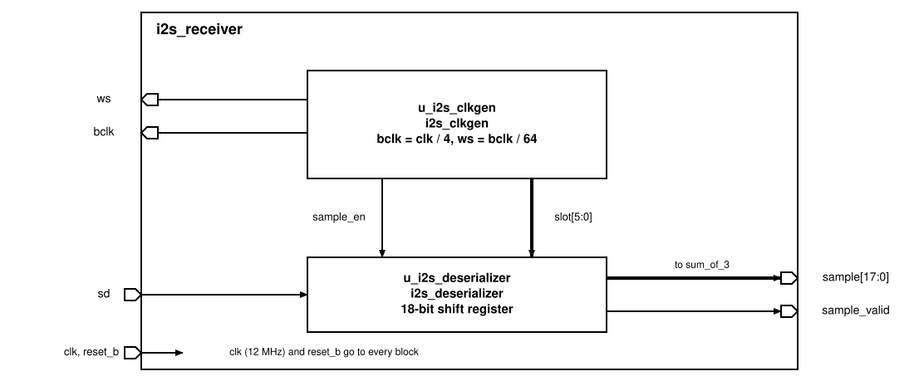
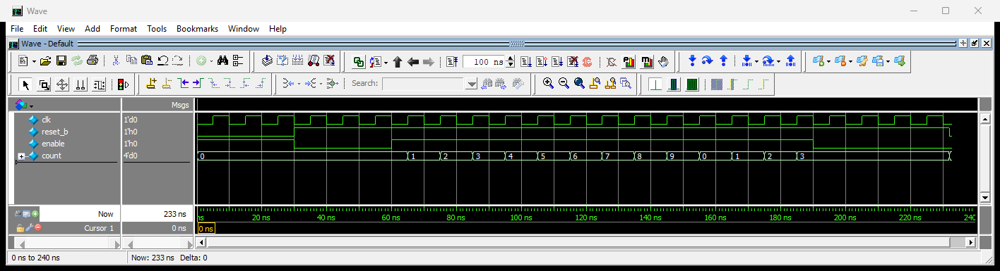
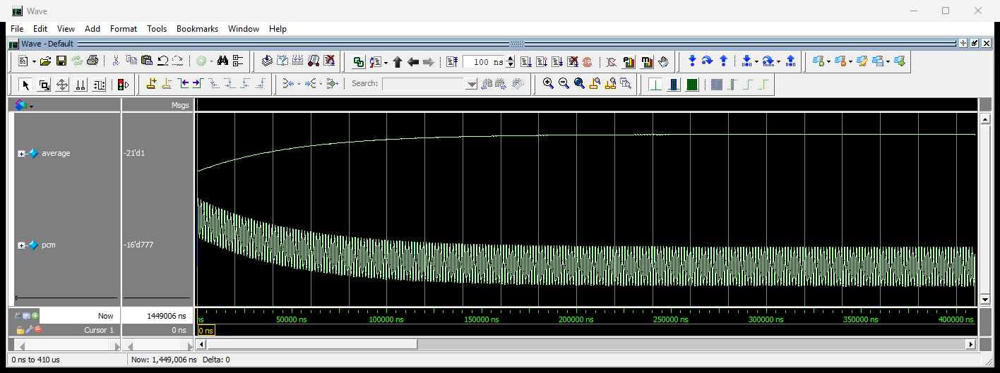

## Overview

The FPGA handles the audio work that has to keep up with the microphone in
real time. It reads samples from the SPH0645 microphone over I2S, adds each
group of 3 samples, removes the DC offset, stores the samples in a ring buffer,
runs a 512-point FFT every 20 ms, and sends the result to the MCU over SPI.

## Block Diagram

::: {.column-page}
{#fig-fpga-top fig-alt="Block diagram of fpga_top. The SPH0645 microphone sits outside the FPGA on the left: the FPGA sends it bclk and ws, and it sends back sd. Inside fpga_top the blocks run left to right: u_i2s_receiver, u_sum_of_3, u_dc_removal, u_ring_buffer, u_fft_controller with the 512-point fft, and u_spi_frame_tx. sample[17:0] and sample_valid, sum[19:0] and sum_valid, and pcm[15:0] and pcm_valid pass between the first four. The ring buffer sends read_data[15:0] and frame_ready to the FFT controller, which returns read_index[8:0]. The FFT controller sends bin_we, bin_addr[7:0], bin_data[31:0], bins_done and frame_num[7:0] to the SPI driver, which drives spi_sck, spi_mosi and spi_cs_b to the MCU. u_hsosc makes the 12 MHz clk; clk and reset_b go to every block."}
:::

[](https://github.com/GabeAlencar/AVIPEe155/blob/main/docs/blockDiagrams/fpga_top.circuitpaint.json)

## fpga_top {#mod-top}

[`fpga_top.sv`](https://github.com/GabeAlencar/AVIPEe155/blob/main/fpga/src/fpga_top.sv)
connects the blocks in a chain and holds only module instances. Each block
hands the next one a value and a one-clock valid strobe, so the whole chain
runs on one 12 MHz clock from the iCE40's internal oscillator (HSOSC, 48 MHz
divided by 4).

| Module | What it does |
|---|---|
| [i2s_receiver](#mod-receiver) | Drives bclk and ws and reads 18-bit samples from the microphone. |
| [sum_of_3](#mod-sum3) | Adds each group of 3 samples into one 20-bit sum. |
| [dc_removal](#mod-dc) | Subtracts a running average and saturates to 16 bits. |
| [ring_buffer](#mod-ring) | Keeps the last 512 samples in block RAM and starts a new frame every 312 samples. |
| fft_controller + fft | Loads each frame into the 512-point FFT, runs it, and reads out X[0] to X[255]. The FFT is Katie's and is described on its own page. |
| [spi_frame_tx](#mod-spi) | Sends each FFT frame to the MCU as an SPI master. |

: Modules inside fpga_top

| Signal | Width | Rate | Between |
|---|---|---|---|
| bclk, ws, sd | 1 bit each | 3 MHz, 46.875 kHz | microphone and i2s_receiver |
| sample, sample_valid | 18 bits | 46.875 kHz | i2s_receiver and sum_of_3 |
| sum, sum_valid | 20 bits | 15.625 kHz | sum_of_3 and dc_removal |
| pcm, pcm_valid | 16 bits | 15.625 kHz | dc_removal and ring_buffer |
| frame_ready | 1 bit | every 312 samples (20 ms) | ring_buffer and fft_controller |
| read_index, read_data | 9 bits in, 16 bits out | one per clk while loading | fft_controller and ring_buffer |
| bin_we, bin_addr, bin_data, bins_done, frame_num | 1, 8, 32, 1, 8 bits | 256 bins per frame | fft_controller and spi_frame_tx |
| spi_sck, spi_mosi, spi_cs_b | 1 bit each | 3 MHz sck, one frame every 20 ms | spi_frame_tx and the MCU |

: Signals along the chain

`fpga_top` also has a copy of the SPI frame on a UART (`uart_frame_tx`, pin 14)
that goes to the PC over the UPduino's USB port. It is only for testing and
plotting the FFT live, so it is not part of the design described here.

::: {.callout-note collapse="true" title="Fpga_top.sv source code"}
```{.systemverilog filename="fpga/src/fpga_top.sv" include="../fpga/src/fpga_top.sv"}
```
:::

### i2s_receiver {#mod-receiver}

The I2S receiver turns the microphone's serial data into one 18-bit two's
complement sample per frame. The FPGA is the I2S master: it makes the bit clock
(`bclk`) and word select (`ws`) from its 12 MHz clock, and the microphone sends
data on `sd` in time with them. The microphone's SEL pin is tied to GND, so it
sends on the left channel, while `ws` is low.

| Signal | Rate | How it is made |
|---|---|---|
| clk | 12 MHz | iCE40 internal HSOSC, 48 MHz / 4 (fpga_top) |
| bclk | 3 MHz | 12 MHz / 4 |
| ws | 46.875 kHz | 3 MHz / 64, so each frame is 64 bclk periods |
| sample | 46.875 kHz | One 18-bit word per frame, with a one-clock sample_valid strobe |

: I2S receiver clocks and rates

| Module | What it does |
|---|---|
| [i2s_clkgen](#mod-clkgen) | Makes bclk and ws, and tells the deserializer when to read sd (sample_en) and which bit it is (slot). |
| [counter](#mod-counter) | Enabled up-counter that wraps at MAX, reused from Lab 3. i2s_clkgen uses two of them. |
| [i2s_deserializer](#mod-deserializer) | Shifts in bits 1 to 18 of the left channel, MSB first, and outputs the finished word. |

: Modules inside i2s_receiver

{#fig-i2s-receiver fig-alt="Block diagram of i2s_receiver. u_i2s_clkgen (bclk = clk / 4, ws = bclk / 64) drives the ws and bclk outputs, and sends sample_en and slot[5:0] down to u_i2s_deserializer, an 18-bit shift register that takes the sd input and drives sample[17:0] and sample_valid to sum_of_3. clk (12 MHz) and reset_b go to every block."}

`i2s_receiver` has two parameters. `DATA_WIDTH` (default 18) sets how many bits
are kept from each word, starting at the MSB. `CHANNEL` (default 0) picks the
left or right channel.

#### Reading a word

Each half frame is 32 `bclk` periods, called slots. `ws` falls at the start of
slot 0. The microphone sees the new `ws` on the next rising edge of `bclk` and
sends the MSB 7 to 66 ns after it, then one bit after each rising edge: 18
data bits, then 6 zeros. The receiver reads each bit one `clk` after `bclk`
falls, at the start of the next slot, so the MSB is read in slot 1 and the last
data bit in slot 18.

{fig-alt="Questa waveform of clk, bclk, ws, sd, sample_en, slot, and the shift register from 42.6 to 44.45 microseconds. ws falls as slot goes from 63 to 0. sample_en pulses once per bclk period, in the clk cycle after bclk falls, and the shift register changes from 13462 to 268C4, 0D189, 1A313, and 34627 on those pulses. sd changes shortly after each bclk rising edge, with short red unknown sections."}

{fig-alt="Questa waveform of bclk, ws, sd, sample, and sample_valid from 43 to 65.5 microseconds. sd is high for 17 bits while ws is low, with short red unknown marks after each bclk rise, then dashed while the microphone leaves it undriven. sample changes from 13462 to 1FFFF when sample_valid pulses."}

In these screenshots, the short red marks on `sd` are where the microphone model
drives an unknown value between 7 ns and 40 ns after each `bclk` rise, the
window where the datasheet allows the data to change. The dashed sections are
`sd` pulled low while the microphone leaves it undriven.

::: {.callout-note collapse="true" title="I2s_receiver.sv source code"}
```{.systemverilog filename="fpga/src/i2s_receiver.sv" include="../fpga/src/i2s_receiver.sv"}
```
:::

#### i2s_clkgen {#mod-clkgen}

`i2s_clkgen` makes the two I2S clocks from the 12 MHz `clk` and tells the
deserializer when to read `sd`. One counter, `phase`, counts the 4 `clk`
cycles in each `bclk` period. The other, `bit_cnt`, counts the 64 `bclk`
periods in each frame and only advances when `phase` wraps from 3 to 0.

- `bclk = phase[1]`, so `bclk` is low for phases 0 and 1 and high for phases 2 and 3.
- `ws = bit_cnt[5]`, so `ws` is low for slots 0 to 31 (left) and high for 32 to 63 (right).
- `bit_cnt` advances on the same `clk` edge that makes `bclk` fall, so `ws`
  always changes on a falling edge of `bclk`, as the microphone requires.
- `sample_en` is high when `phase == 0`, so the deserializer reads `sd` on the
  `clk` edge where `phase` becomes 1, one `clk` after `bclk` falls.
- `slot` is `bit_cnt`, the slot being read.

| phase | 0 | 1 | 2 | 3 |
|---|---|---|---|---|
| bclk | 0 | 0 | 1 | 1 |
| sample_en | 1 | 0 | 0 | 0 |
| What happens | bclk just fell; sd is read at the end of this phase | | bclk just rose; the microphone changes sd 7 to 66 ns later | bit_cnt advances at the end of this phase |

: One bclk period

The microphone changes `sd` 7 to 66 ns after each rising edge of `bclk`. The
read is 250 ns after the rise that sent the bit, so `sd` has been stable for at
least 184 ns and stays stable for at least 90 ns more.

![The clock generator after reset. phase counts 0 to 3, bclk is phase[1], and sample_en pulses in phase 0, the cycle after bclk falls.](images/fpga/i2s_clkgen_start.png){fig-alt="Questa waveform of clk, reset_b, phase, bclk, sample_en, slot, and ws from 0 to 420 ns. After reset_b rises, phase counts 0 to 3 repeatedly, bclk is high for phases 2 and 3, sample_en pulses once per bclk period during phase 0, and slot counts up from 0."}

{fig-alt="Questa waveform of clk, phase, bclk, sample_en, slot, and ws from 1140 to 1470 ns. ws rises at the same time bclk falls, as slot goes from 31 to 32, and sample_en pulses in the following clk cycle."}

::: {.callout-note collapse="true" title="I2s_clkgen.sv source code"}
```{.systemverilog filename="fpga/src/i2s_clkgen.sv" include="../fpga/src/i2s_clkgen.sv"}
```
:::

##### counter {#mod-counter}

[`counter.sv`](https://github.com/GabeAlencar/AVIPEe155/blob/main/fpga/src/counter.sv)
counts up by one on each `clk` edge where `enable` is high, and wraps from `MAX`
back to 0. `WIDTH` sets the number of bits. In [`i2s_clkgen`](#mod-clkgen),
`phase` uses `WIDTH = 2`, `MAX = 3` with `enable` tied high, and `bit_cnt` uses
`WIDTH = 6`, `MAX = 63`, enabled once per `bclk` period. In
[`sum_of_3`](#mod-sum3), `sample_count` uses `WIDTH = 2`, `MAX = 2`, enabled by
`sample_valid`. In [`ring_buffer`](#mod-ring), `write_addr` uses `WIDTH = 9`,
`MAX = 511` and `hop_count` uses `WIDTH = 9`, `MAX = 311`, both enabled by
`pcm_valid`.

{fig-alt="Questa waveform of clk, reset_b, enable, and count from 0 to 240 ns. count steps 1 through 9, wraps to 0, steps to 3, holds at 3 while enable is low, and returns to 0 when reset_b falls."}

::: {.callout-note collapse="true" title="Counter.sv source code"}
```{.systemverilog filename="fpga/src/counter.sv" include="../fpga/src/counter.sv"}
```
:::

#### i2s_deserializer {#mod-deserializer}

[`i2s_deserializer.sv`](https://github.com/GabeAlencar/AVIPEe155/blob/main/fpga/src/i2s_deserializer.sv)
shifts in one channel of I2S data, MSB first. It shifts on `clk` edges where
`sample_en` is high, `slot` is in its channel's half of the frame (`slot[5]`
equals `CHANNEL`), and the slot within that half is 1 to `DATA_WIDTH`. The
SPH0645 sends 18 bits of data in a 24-bit word, so `DATA_WIDTH = 18` keeps
every bit that carries data.

`sample` is the shift register itself, with no separate output register. When
the last bit is shifted in, `sample_valid` is high for one `clk` on the next
cycle. The shift register then stops until slot 1 of the next frame, so
`sample` holds the finished word for the rest of the frame.

::: {.callout-note collapse="true" title="I2s_deserializer.sv source code"}
```{.systemverilog filename="fpga/src/i2s_deserializer.sv" include="../fpga/src/i2s_deserializer.sv"}
```
:::

### sum_of_3 {#mod-sum3}

[`sum_of_3.sv`](https://github.com/GabeAlencar/AVIPEe155/blob/main/fpga/src/sum_of_3.sv)
takes each 18-bit `sample` from the I2S receiver when `sample_valid` pulses,
adds each group of 3, and outputs one 20-bit `sum` with a one-clock
`sum_valid` strobe. This drops the sample rate from 46.875 kHz to
15.625 kHz, so a 512-point FFT covers 32.8 ms of sound with 30.5 Hz bins up
to 7.8 kHz.

| Signal | Width | Rate |
|---|---|---|
| sample (in) | 18 bits, two's complement | 46.875 kHz, with sample_valid |
| sum (out) | 20 bits, two's complement | 15.625 kHz, with sum_valid |

: sum_of_3 inputs and outputs

#### How it adds

The [`counter`](#mod-counter) `sample_count` steps 0, 1, 2 on each `sample_valid`
and then wraps, so it says which sample of the group is arriving. On a valid
sample:

- If `sample_count` is 0, `partial_sum` loads the sample, which starts a new
  group without a separate clear step.
- Otherwise `partial_sum` adds the sample to the sum so far.
- If `sample_count` is 2 (`last_sample`), `sum_valid` pulses one `clk` later,
  while `partial_sum` holds the finished sum.

`sum` is `partial_sum` itself, with no separate output register. After the third
sample it holds the finished sum until the next group starts, which is at least
256 `clk` later, and `dc_removal` reads it on the `sum_valid` pulse. Between
pulses `sum` shows the running total. Samples can still arrive on back-to-back
clock cycles; the receiver only sends one every 256 `clk`, so the block has
plenty of time. Reset clears `sample_count`, so the
first sample after reset starts a group.

The sum is 2 bits wider than a sample. Each sample is sign-extended by copying
its MSB into the 2 new bits, and the extremes fit with room to spare:
3 × 131071 = 393213 and 3 × −131072 = −393216, inside the 20-bit range of
−524288 to 524287. The block keeps the sum instead of dividing by 3, since the
sum is just 3 times the average and dividing would cost extra logic.

#### Filtering

Adding 3 samples and keeping one sum is a simple low-pass filter followed by
keeping every third result. Its gain is
$|H(f)| = \left|\frac{\sin(3\pi f / f_s)}{\sin(\pi f / f_s)}\right|$
with $f_s$ = 46.875 kHz. That is 3 at DC and 2 at 7.8 kHz, the top of the
output band, so high notes are only 3.5 dB lower. It has zeros at 15.625 kHz
and 31.25 kHz, the frequencies that would fold onto DC. Sound between 7.8 and
15.6 kHz is only partly reduced (for example 6 dB at 10 kHz) and can still
fold into the band, so that is a limit of this simple filter.

::: {.callout-note collapse="true" title="Sum_of_3.sv source code"}
```{.systemverilog filename="fpga/src/sum_of_3.sv" include="../fpga/src/sum_of_3.sv"}
```
:::

### dc_removal {#mod-dc}

[`dc_removal.sv`](https://github.com/GabeAlencar/AVIPEe155/blob/main/fpga/src/dc_removal.sv)
takes each 20-bit `sum` from [`sum_of_3`](#mod-sum3) when `sum_valid` pulses,
subtracts a slow running average to remove the microphone's DC offset, and
outputs a 16-bit `pcm` sample with a one-clock `pcm_valid` strobe. A DC offset
would put a large spike in the FFT's first bin and use up range the sound
needs, so it comes out before the ring buffer.

| Signal | Width | Rate |
|---|---|---|
| sum (in) | 20 bits, two's complement | 15.625 kHz, with sum_valid |
| pcm (out) | 16 bits, two's complement | 15.625 kHz, with pcm_valid |

: dc_removal inputs and outputs

#### Running average

On each `sum_valid`, the average moves 1/1024 of the way toward the new sum:

$$\text{average} \leftarrow \text{average} + \frac{\text{sum} - \text{average}}{1024}$$

Dividing by 1024 is a shift, so the block needs no multiplier. To keep the
small steps from being rounded away, `average_acc` holds the average times
1024, which is 10 extra fraction bits (31 bits in all). Each valid sum does:

- `average` = `average_acc >>> 10`, the whole part of the average.
- `difference` = `sum − average`, the sample with the DC removed.
- `average_acc` ← `average_acc + difference`, so the average moves by
  `difference` / 1024.

The output uses the average from before the update. The first sum after reset
passes through unchanged, since the average starts at 0.

The shift is set by `AVERAGE_SHIFT = 10`. At 15.625 kHz that gives a time
constant of 1024 samples (65.5 ms), so after a change in the offset, 37% is
left after 65.5 ms and about 1% after 0.3 s. The cutoff is 2.4 Hz, far below
the FFT's first 30.5 Hz bin, so even the lowest notes pass. The average rounds
down, but once the input holds still, `average` equals the input exactly and
the output settles at 0.

{fig-alt="Questa analog waveform of average and pcm from 0 to 410 microseconds. average curves up from 0 and levels off. pcm is a dense tone whose center starts high and drifts down until it is centered on 0."}

The simulation sends a sum every 4 `clk` instead of every 768, so the figure
shows in 410 µs what takes about 0.66 s in hardware.

#### Saturating to 16 bits

`difference` can be up to 21 bits, but the ring buffer and FFT use 16-bit
samples. The output register keeps the low 16 bits and clamps anything outside the
16-bit range to 32767 or −32768, so a loud sound clips instead of wrapping
around to the opposite sign. Keeping the low bits instead of the top bits is
the gain from the proposal. Compared with one 18-bit sample cut down to 16 bits
by dropping its 2 lowest bits, the output is 12 times larger: 3 from the sum
and 4 from keeping the low bits. That lifts speech at 65 dB SPL well above the
bottom bits, and sound above about 98 dB SPL clips.

{fig-alt="Questa waveform of clk, sum_valid, sum, average_acc, average, pcm, and pcm_valid. Three sum_valid pulses read 393213, -393216, and 12767. pcm becomes 32767, -32768, and 32728, and average steps from -20000 to -19596, -19961, and -19929."}

::: {.callout-note collapse="true" title="Dc_removal.sv source code"}
```{.systemverilog filename="fpga/src/dc_removal.sv" include="../fpga/src/dc_removal.sv"}
```
:::

### ring_buffer {#mod-ring}

[`ring_buffer.sv`](https://github.com/GabeAlencar/AVIPEe155/blob/main/fpga/src/ring_buffer.sv)
stores every `pcm` sample from [`dc_removal`](#mod-dc) in a 512 × 16 block RAM,
overwriting the oldest one, so it always holds the last 512 samples
(32.8 ms). Every 312 samples (20 ms) it pulses `frame_ready` for one `clk`.
[`fft_controller`](#mod-top) then reads the frame through `read_index`, oldest first, so
the FFT sees a new 512-sample window every 20 ms, overlapping the last one by 200
samples.

| Signal | Width | What it is |
|---|---|---|
| pcm, pcm_valid (in) | 16 bits | one sample every 768 clk (15.625 kHz) |
| frame_ready (out) | 1 bit | one-clk pulse every 312 samples, once 512 are stored |
| read_index (in) | 9 bits | 0 is the oldest sample of the frame, 511 the newest |
| read_data (out) | 16 bits | the sample at read_index, one clk later |

: ring_buffer inputs and outputs

#### How it works

- The [`counter`](#mod-counter) `write_addr` (0 to 511) steps on each
  `pcm_valid`, and the RAM writes `pcm` there on the same edge.
- The [`counter`](#mod-counter) `hop_count` (0 to 311) also steps on each
  `pcm_valid`. On the 312th sample of each hop, if the buffer has filled,
  `frame_ready` pulses one `clk` later.
- On that same sample, `frame_start` saves `write_addr + 1`: the address after
  the newest sample holds the oldest one still kept. The read address is
  `frame_start + read_index`, which wraps around the end of the RAM by itself
  since both are 9 bits.
- A `filled` flag sets once all 512 addresses have been written, so no frame
  comes out with stale RAM contents after reset. The first frame comes at 624
  samples, the first hop boundary after 512.

The RAM has one write port and one read port, so the frame can be read while
new samples are written. The next sample after `frame_ready` overwrites the
oldest sample of the frame (`read_index` 0), but not until 767 `clk` after
`frame_ready`. A reader that asks for `read_index` 0 less than 767 `clk` after
`frame_ready` always gets the whole frame before anything in it changes.
`fft_controller` starts reading 2 `clk` after `frame_ready` and reads all 512
samples in 512 `clk`.

{fig-alt="Questa waveform of clk, pcm_valid, pcm, write_addr, hop_count, filled, frame_ready, frame_start, read_index, and read_data from 24.88 to 25.08 microseconds. write_addr steps 110, 111, 112 and hop_count steps 310, 311, 0 on pcm_valid pulses. frame_ready pulses for one clk and frame_start changes from 312 to 112. read_index counts 0, 1, 2 and read_data follows one clk later with A570, A571, A572."}

::: {.callout-note collapse="true" title="Ring_buffer.sv source code"}
```{.systemverilog filename="fpga/src/ring_buffer.sv" include="../fpga/src/ring_buffer.sv"}
```
:::

#### dual_port_ram {#mod-ram}

[`dual_port_ram.sv`](https://github.com/GabeAlencar/AVIPEe155/blob/main/fpga/src/dual_port_ram.sv)
is written like `sbox_sync` from Lab 7: the memory is an array, and the read
happens inside `always_ff`, so `read_data` is a register. A synchronous read
is what lets Radiant build the memory from block RAM instead of logic cells.
Each UP5K EBR block holds 256 × 16 bits, so 512 × 16 takes 2 of the 30
blocks, and the synthesis report confirms 2 EBRs. The RAM has no reset
because a reset cannot clear block RAM contents, which is why
[`ring_buffer`](#mod-ring) waits until all 512 addresses are written before its
first frame.

| Port | Width | What it does |
|---|---|---|
| write_en, write_addr, write_data | 1, 9, 16 bits | writes write_data at write_addr on each clk edge where write_en is high |
| read_addr, read_data | 9, 16 bits | read_data is the word at read_addr one clk later |

: dual_port_ram ports

::: {.callout-note collapse="true" title="Dual_port_ram.sv source code"}
```{.systemverilog filename="fpga/src/dual_port_ram.sv" include="../fpga/src/dual_port_ram.sv"}
```
:::

### spi_frame_tx {#mod-spi}

[`spi_frame_tx.sv`](https://github.com/GabeAlencar/AVIPEe155/blob/main/fpga/src/spi_frame_tx.sv)
sends each FFT frame to the MCU. The FPGA is the SPI master and drives the
clock, so the MCU only has to listen as a slave. It uses SPI mode 0: `sck`
idles low, `mosi` changes on the falling edge of `sck`, and the MCU reads it on
the rising edge, MSB first, in 16-bit words. `spi_cs_b` is low for the whole
frame.

| Word | Value |
|---|---|
| 0 | `16'hA55A`, a sync word so the MCU can check it is lined up |
| 1 | `{frame number, STAGE_SHIFT}`, 8 bits each: `0001`, `0101`, `0201`, ... |
| 2, 3 | real and imaginary part of X[0] |
| ... | |
| 512, 513 | real and imaginary part of X[255] |

: One SPI frame, 514 words

Each X[k] is a signed 16-bit number equal to the FFT divided by 512, the
scaling set by `STAGE_SHIFT = 1`. Bin k is at k × 15,625 / 512 Hz, about
30.5 Hz per bin. Only bins 0 to 255 are sent: the input is real, so bins 256
to 511 are the complex conjugates of these and carry no new information.

| Port | Width | What it is |
|---|---|---|
| we, waddr, wdata (in) | 1, 8, 32 bits | X[waddr] as {re, im}, one per clk from fft_controller |
| send (in) | 1 bit | one-clk pulse after X[255]: send this frame |
| frame_num (in) | 8 bits | frame number for word 1 |
| sck, mosi, cs_b (out) | 1 bit each | the SPI pins |

: spi_frame_tx inputs and outputs

#### How it sends

- **Its own copy of the bins.** The 256 bins go into a 256 × 32
  [`dual_port_ram`](#mod-ram) as `fft_controller` reads them out of the FFT,
  so the FFT can start the next frame while this one is still being sent. A
  frame is only taken if the driver is idle when X[0] arrives (`taking`). If
  a frame arrives while the last one is still going out, it is skipped and
  the frame number shows the gap. At 3 MHz that never happens: a frame takes
  2.8 ms and a new one comes every 20 ms.
- **Two states.** In `IDLE` the driver waits for `send`. In `SEND` it starts
  the next word on [`spi_word_tx`](#mod-spiword) as soon as the last one is
  out, and counts words with `word_idx`. After word 513 finishes it goes back
  to `IDLE`. The RAM read for the next word finishes long before it is needed,
  since each word takes 64 `clk`.
- **Which word.** Words 0 and 1 are the header. For words 2 to 513,
  `word_idx − 2` gives the bin (the upper bits) and real or imaginary
  (the lowest bit).
- **Chip select.** `cs_b` comes from a flip-flop (`cs_b <= (nextstate == IDLE)`)
  so the pin cannot glitch. It falls 3 `clk` (250 ns) before the first rising
  edge of `sck` and rises 1 `clk` (83 ns) after the last falling edge.

A frame is 514 × 16 = 8,224 `sck` pulses. `sck` is low for one extra `clk`
between words, so each word takes 65 `clk` and the whole frame about
33,400 `clk`, or 2.8 ms.

::: {.callout-note collapse="true" title="Spi_frame_tx.sv source code"}
```{.systemverilog filename="fpga/src/spi_frame_tx.sv" include="../fpga/src/spi_frame_tx.sv"}
```
:::

#### spi_word_tx {#mod-spiword}

[`spi_word_tx.sv`](https://github.com/GabeAlencar/AVIPEe155/blob/main/fpga/src/spi_word_tx.sv)
sends one word in SPI mode 0, MSB first. A word starts when `start` is high
while `busy` is low. The word goes into a shift register, and `sdo` is its MSB
right away. A counter `div` counts `HALF_PERIOD` `clk` cycles for each half of
`sck`:

- After the first half, `sck` rises. The receiver reads `sdo` here.
- After the second half, `sck` falls and the shift register moves the next bit
  onto `sdo`.
- `busy` stays high from the `clk` after `start` until the last falling edge,
  after `WIDTH` bits.

With `HALF_PERIOD = 2`, `sck` is high for 2 `clk` and low for 2 `clk`: 3 MHz,
the same as `bclk`. `sdo` changes on the falling edge, half a period
(167 ns) before the MCU reads it and half a period after, so the timing has
plenty of margin. `sck` and `sdo` both come straight from flip-flops, so they
cannot glitch.

| Port | Width | What it is |
|---|---|---|
| start, data (in) | 1, 16 bits | load data and start sending, when busy is low |
| busy (out) | 1 bit | high while a word is being sent |
| sck, sdo (out) | 1 bit each | SPI clock and data |

: spi_word_tx inputs and outputs

::: {.callout-note collapse="true" title="Spi_word_tx.sv source code"}
```{.systemverilog filename="fpga/src/spi_word_tx.sv" include="../fpga/src/spi_word_tx.sv"}
```
:::

## Pin Assignments

The pins are set in
[`AVIPEe155.pdc`](https://github.com/GabeAlencar/AVIPEe155/blob/main/fpga/Radiant/AVIPEe155/AVIPEe155.pdc).
Names are the ones on the E155 breadboard adapter schematic. Keep the dev
board's DIP switch SW7 off, since it connects MCU pins to some FPGA pins.

| Signal | FPGA pin | Adapter header | Connects to |
|---|---|---|---|
| bclk | P11 | J1-4 | microphone BCLK |
| ws | P6 | J1-5 | microphone LRCL |
| sd | P48 | J1-7 | microphone DOUT |
| reset_b | P34 | SW0 | dev board push button, internal pull-up |
| spi_sck | P46 | J3-12 | MCU SCK |
| spi_mosi | P45 | J3-13 | MCU MOSI |
| spi_cs_b | P3 | J3-14 | MCU chip select |
| fft_busy | P44 | J3-15 | high while the FFT runs, a scope trigger |
| uart_tx | P14 | none | UPduino USB serial port, for testing |

: FPGA pins

The microphone runs from +3V3 (J3-2) and GND (J3-1). Its SEL pin goes to GND
for the left channel.

## Resources and Timing

From Lattice Radiant place and route, with `fpga_top` as the top level
(including the UART test copy):

| Resource | Used | Of | |
|---|---|---|---|
| LUT4s | 1,204 | 5,280 | 23% |
| Registers | 291 | 5,280 | 6% |
| Block RAM (EBR) | 12 | 30 | ring buffer 2, FFT data 4, twiddle ROM 2, SPI and UART frame copies 2 each |
| DSP blocks | 4 | 8 | the FFT's complex multiply |
| I/O pins | 9 | 39 | |

: Resource use

The design runs on one 12 MHz clock (83.3 ns period) and meets setup and hold
timing on every path. The slowest path is inside the FFT: a RAM read through
the complex multiply and add back into the FFT RAM. It has 1.05 ns of slack,
so the design would run up to about 12.15 MHz. The rest of the chain has far
more margin.

