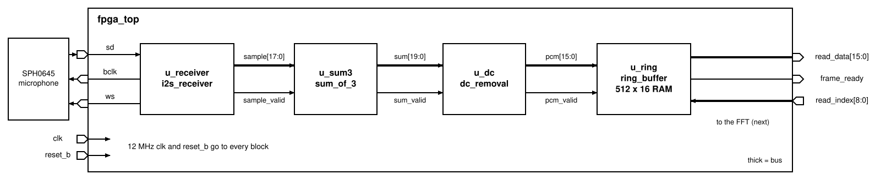
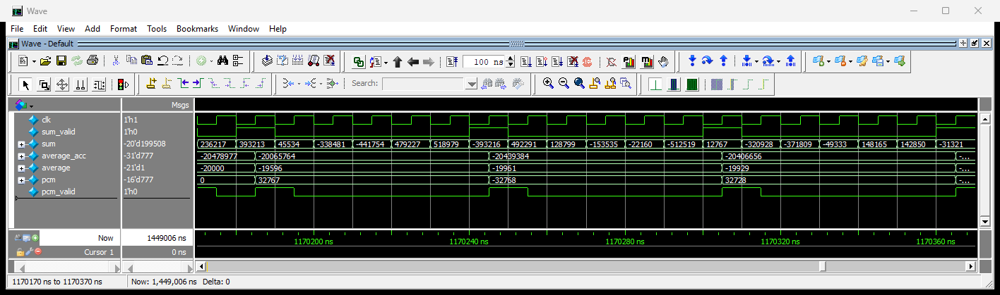
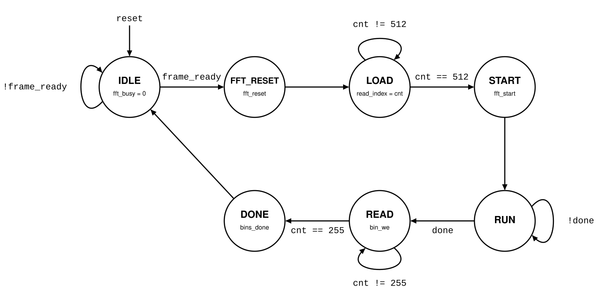
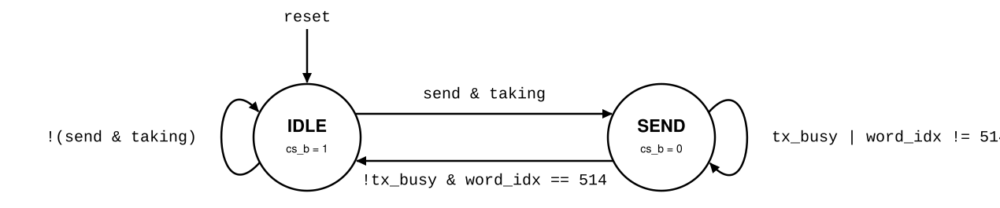
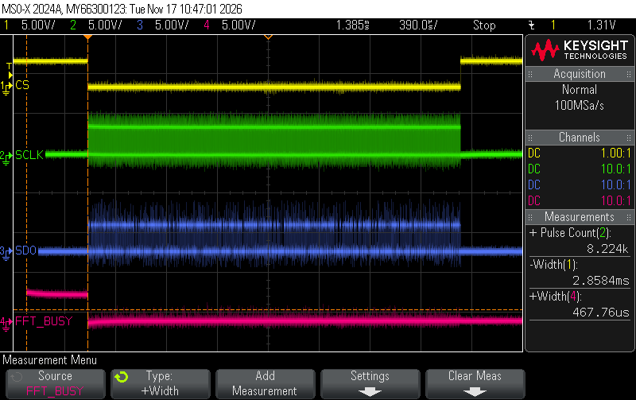
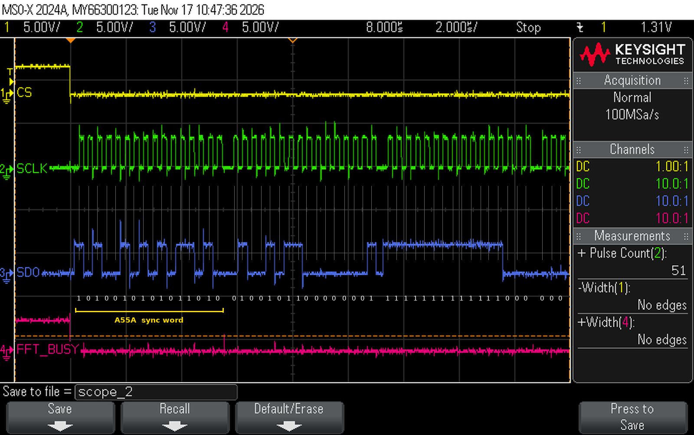

## Overview

The FPGA does the audio work that has to keep up with the microphone in real
time. It reads 18-bit samples from the SPH0645 microphone over I2S, adds each
group of 3 samples, removes the DC offset, and keeps the last 512 samples in a
ring buffer. Every 20 ms it runs a 512-point FFT on those samples and sends the
first 256 bins to the MCU over SPI. Every block runs on one 12 MHz clock from
the iCE40's internal oscillator and each block hands the
next one a value with a one-clock valid strobe.

The animation below follows one sample through the chain, from the bits the
microphone sends to the frame that goes to the MCU.

::: {.column-page}

:::

::: {.column-page}
{#fig-fpga-top fig-alt="Block diagram of fpga_top. The SPH0645 microphone sits outside the FPGA on the left: the FPGA sends it bclk and ws, and it sends back sd. Inside fpga_top the blocks run left to right: u_i2s_receiver, u_sum_of_3, u_dc_removal, u_ring_buffer, u_fft_controller with the 512-point fft, and u_spi_frame_tx. The ring buffer sends read_data and frame_ready to the FFT controller, which returns read_index. The FFT controller sends the bins to the SPI driver, which drives spi_sck, spi_mosi and spi_cs_b. u_hsosc makes the 12 MHz clk."}
:::

## Modules

### fpga_top

`fpga_top` holds the module instances and wires them in a chain. (`i2s_receiver`, `sum_of_3`, `dc_removal`, `ring_buffer`, `fft_controller`, and `spi_frame_tx`)

::: {.callout-note collapse="true" title="fpga_top.sv"}
```{.systemverilog filename="fpga/src/fpga_top.sv" include="../fpga/src/fpga_top.sv"}
```
:::

### i2s_receiver

`i2s_receiver` reads the microphone. It contains `i2s_clkgen`, which makes the
I2S clocks, and `i2s_deserializer`, which turns the serial bits back into
18-bit samples.

#### I2S protocol

I2S sends audio over three wires. The FPGA is the master, so it drives the bit
clock `bclk` (12 MHz / 4 = 3 MHz) and the word select `ws`, and the microphone
answers on `sd`. Each frame is one `ws` period of 64 `bclk` periods, called
slots: `ws` is low for slots 0 to 31 (the left channel) and high for 32 to 63
(the right). `i2s_clkgen` counts these slots with two `counter`s, so a frame
comes every 64 × 333 ns, which sets the sample rate to 46.875 kHz. The SEL pin
is tied to GND, so the microphone only talks in the left half. It sends a
24-bit two's complement word, MSB first, changing `sd` just after each rising
edge of `bclk`. Only the top 18 bits carry data, and the MSB comes one `bclk`
after `ws` falls, so it is read in slot 1 and the last data bit in slot 18.

#### i2s_deserializer

`i2s_deserializer` is an 18-bit shift register. `i2s_clkgen` gives it the
current `slot` and a one-clock `sample_en` pulse in each slot, one `clk` after
`bclk` falls, when `sd` has been stable for about 180 ns. The register shifts
in `sd` only when `sample_en` is high and the slot is 1 to 18 of the left half.
Each shift moves the word left and puts the new bit at the bottom, so after
slot 18 the register holds the whole sample, and `sample_valid` pulses for one
`clk`. The shift register is the `sample` output itself and does not change
again until the next frame, so `sum_of_3` can read it any time before then.

{fig-alt="Block diagram of i2s_receiver. u_i2s_clkgen drives the ws and bclk outputs and sends sample_en and slot[5:0] to u_i2s_deserializer, an 18-bit shift register that takes sd and drives sample[17:0] and sample_valid."}

::: {.callout-note collapse="true" title="Testbench waveforms"}
![i2s_clkgen after reset. phase counts 0 to 3, bclk is phase[1], and sample_en pulses in phase 0, one clk after bclk falls.](images/fpga/i2s_clkgen_start.png){fig-alt="Questa waveform of clk, reset_b, phase, bclk, sample_en, slot and ws from 0 to 420 ns. After reset_b rises, phase counts 0 to 3, bclk is high for phases 2 and 3, sample_en pulses once per bclk period in phase 0, and slot counts up from 0."}

{fig-alt="Questa waveform of clk, phase, bclk, sample_en, slot and ws from 1140 to 1470 ns. ws rises at the same time bclk falls as slot goes from 31 to 32, and sample_en pulses in the next clk cycle."}

{fig-alt="Questa waveform of clk, bclk, ws, sd, sample_en, slot and shift from 42.6 to 44.45 microseconds. ws falls as slot goes from 63 to 0. sample_en pulses once per bclk period, one clk after bclk falls, and shift changes from 13462 to 268C4, 0D189, 1A313 and 34627 on those pulses."}

{fig-alt="Questa waveform of clk, reset_b, enable and count from 0 to 240 ns. count steps 1 through 9, wraps to 0, steps to 3, holds at 3 while enable is low, and returns to 0 when reset_b falls."}
:::

::: {.callout-note collapse="true" title="i2s_receiver.sv, i2s_clkgen.sv, i2s_deserializer.sv, counter.sv"}
```{.systemverilog filename="fpga/src/i2s_receiver.sv" include="../fpga/src/i2s_receiver.sv"}
```
```{.systemverilog filename="fpga/src/i2s_clkgen.sv" include="../fpga/src/i2s_clkgen.sv"}
```
```{.systemverilog filename="fpga/src/i2s_deserializer.sv" include="../fpga/src/i2s_deserializer.sv"}
```
```{.systemverilog filename="fpga/src/counter.sv" include="../fpga/src/counter.sv"}
```
:::

### sum_of_3

`sum_of_3` adds each group of 3 samples into one 20-bit sum, which drops the
sample rate from 46.875 kHz to 15.625 kHz. A 512-point FFT then covers 32.8 ms
of sound with 30.5 Hz bins up to 7.8 kHz. A `counter` counts which sample of
the group is arriving: the first one loads the running sum and the next two add
to it. The sum is 2 bits wider than a sample, so it cannot overflow. Adding
the 3 samples acts as a low-pass filter.

::: {.callout-note collapse="true" title="sum_of_3.sv"}
```{.systemverilog filename="fpga/src/sum_of_3.sv" include="../fpga/src/sum_of_3.sv"}
```
:::

### dc_removal

The microphone output has a DC offset, which would put a large spike in the
FFT's first bin. `dc_removal` subtracts a slow running average from each sum.
On each sample the average moves 1/1024 of the way toward the new value, which
is a shift instead of a divide (`AVERAGE_SHIFT = 10`). The average is kept with
10 extra fraction bits so the small steps are not rounded away. This removes
everything below about 2.4 Hz, far under the FFT's first 30.5 Hz bin. The
result is clamped to 16 bits, so a very loud sound clips instead of wrapping
around to the opposite sign.

`AVERAGE_SHIFT` sets how slowly the average moves. `average_acc` holds the
average times 2^10 = 1024, and each sample the block adds the whole
`difference = sum − average` to it, so the average itself only moves by
`difference` / 1024. The steps shrink as the average nears the offset, so it
settles in about 0.3 s and the output ends up centered on 0. The shift is a
tradeoff: a larger one gives a steadier average that passes even the lowest
notes, but takes longer to settle after power-up or a change in offset, and
needs a wider `average_acc`. A smaller one settles faster but starts to cut
into the low notes and lets loud sounds pull the average around. 10 settles
quickly and still sits far below the FFT's first 30.5 Hz bin.

::: {.callout-note collapse="true" title="Testbench waveforms"}
{fig-alt="Questa analog waveform of average and pcm from 0 to 410 microseconds. average curves up from 0 and levels off. pcm is a dense tone whose center starts high and drifts down until it is centered on 0."}

{fig-alt="Questa waveform of clk, sum_valid, sum, average_acc, average, pcm and pcm_valid. Three sum_valid pulses read 393213, -393216 and 12767. pcm becomes 32767, -32768 and 32728."}
:::

::: {.callout-note collapse="true" title="dc_removal.sv"}
```{.systemverilog filename="fpga/src/dc_removal.sv" include="../fpga/src/dc_removal.sv"}
```
:::

### ring_buffer

`ring_buffer` writes every 16-bit sample into a 512 × 16 `dual_port_ram`,
overwriting the oldest one, so it always holds the last 512 samples. Every 312
samples (20 ms) it pulses `frame_ready`, and `fft_controller` reads the frame
back oldest first through `read_index`, so each FFT window overlaps the last
one by 200 samples. The RAM has separate read and write ports, so the frame can
be read while new samples keep arriving. The RAM's read is registered, which
lets Radiant build it from 2 of the UP5K's block RAMs, and no frame is sent
until all 512 addresses have been written once after reset.

::: {.callout-note collapse="true" title="Testbench waveforms"}
{fig-alt="Questa waveform of clk, pcm_valid, pcm, write_addr, hop_count, filled, frame_ready, frame_start, read_index and read_data from 24.88 to 25.08 microseconds. write_addr steps 110, 111, 112 and hop_count steps 310, 311, 0. frame_ready pulses for one clk and frame_start changes from 312 to 112. read_index counts 0, 1, 2 and read_data follows one clk later."}
:::

::: {.callout-note collapse="true" title="ring_buffer.sv, dual_port_ram.sv"}
```{.systemverilog filename="fpga/src/ring_buffer.sv" include="../fpga/src/ring_buffer.sv"}
```
```{.systemverilog filename="fpga/src/dual_port_ram.sv" include="../fpga/src/dual_port_ram.sv"}
```
:::

### fft_controller and fft

`fft_controller` is an FSM that runs the FFT once per frame. On `frame_ready` it
resets the FFT, loads the 512 samples from the ring buffer as real inputs,
starts it, and waits about 4,600 clocks for `done`. It then reads out bins
X[0] to X[255] one per clock to the output drivers. The input is real, so the
other 256 bins are mirror images and are not sent. The FFT itself is described
in the riskiest element section: each stage shifts its result down by one bit
(`STAGE_SHIFT = 1`), so the output is the FFT divided by 512 and never
overflows.

#### FSM

`fft_controller` is a Moore FSM with binary state encoding and a 10-bit counter,
`cnt`, that counts samples while loading and bins while reading. The ring
buffer and the FFT RAMs are synchronous, so each read returns its data one
clock after the address. To line the two up, the load strobe (`load_v`) and
the FFT write address (`load_adr`) are delayed one clock behind `read_index`,
which is why `LOAD` runs for 513 clocks instead of 512. `cnt` is cleared twice per frame, in `FFT_RESET` before loading and on `done` before reading. In between it holds its last value, 512 through `START` and `RUN` and 255 through `DONE` and `IDLE`.

{fig-alt="State diagram of fft_controller. reset enters IDLE, which loops on not frame_ready. frame_ready goes to FFT_RESET, then LOAD, which loops while cnt is not 512 and goes to START when cnt equals 512. START goes to RUN, which loops until done, then READ, which loops while cnt is not 255 and goes to DONE when cnt equals 255. DONE returns to IDLE."}

| State | Datapath action | Next state | Outputs |
|---|---|---|---|
| IDLE | Waits for the ring buffer | FFT_RESET if `frame_ready`, else IDLE | none |
| FFT_RESET | `cnt` <= 0, resets the FFT | LOAD | `fft_reset` |
| LOAD | `read_index` = `cnt`, `cnt` <= `cnt` + 1; one clock later each sample is written into the FFT as {pcm, 0} | START if `cnt == 512`, else LOAD | `read_index`, `load_v` |
| START | Starts the FFT | RUN | `fft_start` |
| RUN | The FFT runs its 9 stages; `cnt` <= 0 on `done` | READ if `done`, else RUN | none |
| READ | X[`cnt`] comes out of the FFT on `bin_data`, `cnt` <= `cnt` + 1 | DONE if `cnt == 255`, else READ | `bin_we`, `bin_addr` = `cnt` |
| DONE | `frame_num` <= `frame_num` + 1 | IDLE | `bins_done` |

: fft_controller states

`fft_busy` is high in every state but `IDLE`, so it can trigger a scope for
timing. One frame takes about 5,380 clocks, or 0.45 ms at 12 MHz, so the
controller is idle for over 97% of each 20 ms hop. The output drivers copy the
bins as they come out during `READ`, so the next frame can start right away.

::: {.callout-note collapse="true" title="Testbench waveforms"}
{fig-alt="Questa waveform from 39.921 to 39.966 ms. frame_ready pulses once at the left. read_index is an analog ramp from 0 to 511. read_data is an analog tone of about 33 cycles."}
:::

::: {.callout-note collapse="true" title="fft_controller.sv"}
```{.systemverilog filename="fpga/src/fft_controller.sv" include="../fpga/src/fft_controller.sv"}
```
:::

### spi_frame_tx

`spi_frame_tx` sends each frame to the MCU with the FPGA as the SPI master, in
mode 0 at 3 MHz, MSB first, in 16-bit words. A frame is 514 words: a sync word
(`A55A`), a word with the frame number, and then the real and imaginary parts
of X[0] to X[255]. `cs_b` is low for the whole frame, which takes 2.8 ms of
every 20 ms. The driver keeps its own copy of the bins in a `dual_port_ram`, so
the FFT can start on the next frame while this one is still going out.
`spi_word_tx` shifts out each word.

#### FSM

`spi_frame_tx` is a two-state Moore FSM with a 10-bit word counter,
`word_idx`. While the FFT reads out its bins, the driver writes them into its
RAM, but only if it was in `IDLE` when X[0] arrived (the `taking` flag), so a
frame that is still being sent is never overwritten. When `send` pulses and the
frame was taken, it goes to `SEND`. In `SEND` it starts a word on `spi_word_tx`
every time that block is not busy and adds one to `word_idx`. Word 0 is the
sync word `A55A`, word 1 is `{frame_num, STAGE_SHIFT}`, and for words 2 to 513,
`word_idx − 2` picks the bin (upper bits) and real or imaginary part (lowest
bit) from the RAM. After word 513 finishes it goes back to `IDLE`, which clears
`word_idx`. `cs_b` comes from a flip-flop set from the next state, so it falls
just before the first `sck` edge and rises just after the last, and the pin
cannot glitch.

{fig-alt="State diagram of spi_frame_tx. reset enters IDLE, where cs_b is 1, which loops while not send and taking. send and taking goes to SEND, where cs_b is 0, which loops while tx_busy or word_idx is not 514, and returns to IDLE when tx_busy is low and word_idx equals 514."}

| State | Datapath action | Next state | Outputs |
|---|---|---|---|
| IDLE | `word_idx` <= 0, `frame_num` is saved for word 1, the RAM takes the bins if `taking` | SEND if `send & taking`, else IDLE | `cs_b` = 1 |
| SEND | Starts the next word when `spi_word_tx` is not busy, `word_idx` <= `word_idx` + 1 per word | IDLE if `!tx_busy & word_idx == 514`, else SEND | `cs_b` = 0, `tx_start` |

: spi_frame_tx states

`spi_word_tx` sends one 16-bit word. On `start` it loads the word into a shift
register and sets `busy`, and `sdo` is always the register's MSB. A counter
`div` counts 2 `clk` for each half of `sck` (`HALF_PERIOD = 2`). After the
first half `sck` rises, which is when the MCU reads the bit, and after the
second half `sck` falls and the register shifts the next bit onto `sdo`.
`bits_left` counts down from 16, and `busy` drops after the last falling edge.
Each bit takes 4 `clk`, so `sck` runs at 3 MHz, and a word takes 64 `clk` plus
one idle `clk` before the next starts, about 2.8 ms for the whole frame.

::: {.callout-note collapse="true" title="SPI oscilloscope captures"}
{fig-alt="Keysight oscilloscope capture of CS, SCLK, SDO and FFT_BUSY over about 3.9 ms. CS goes low for one long pulse while SCLK and SDO toggle densely, and FFT_BUSY is high just before CS falls. Measurements: positive pulse count on SCLK 8.224k, negative width of CS 2.8584 ms, positive width of FFT_BUSY 467.76 microseconds."}

{fig-alt="Keysight oscilloscope capture of CS, SCLK, SDO and FFT_BUSY over 20 microseconds, annotated. CS falls, then SCLK sends 51 pulses in groups of 16. The bit read at each rising edge is written under SDO, and a bracket marks the first word, the A55A sync word."}
:::

::: {.callout-note collapse="true" title="spi_frame_tx.sv, spi_word_tx.sv"}
```{.systemverilog filename="fpga/src/spi_frame_tx.sv" include="../fpga/src/spi_frame_tx.sv"}
```
```{.systemverilog filename="fpga/src/spi_word_tx.sv" include="../fpga/src/spi_word_tx.sv"}
```
:::

## Resources and Timing

The design uses 1,204 of the 5,280 LUTs (23%), 12 of the 30 block RAMs, and 4
of the 8 DSP blocks, which do the FFT's complex multiply. It meets timing at
12 MHz, and the slowest path, inside the FFT, has 1.05 ns of slack.
