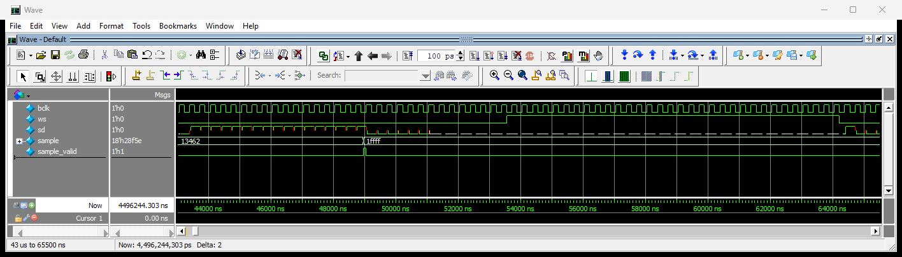
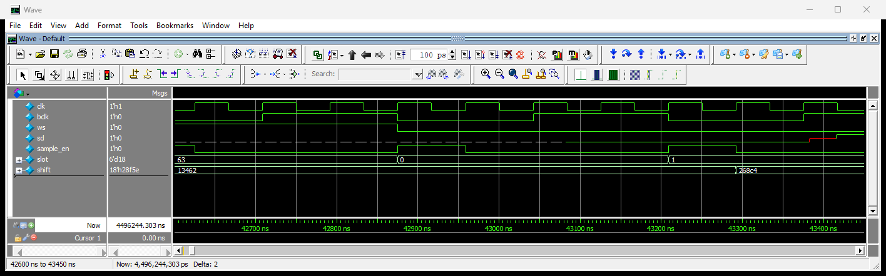
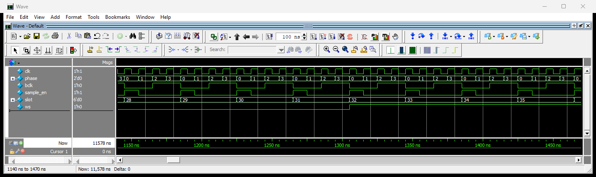
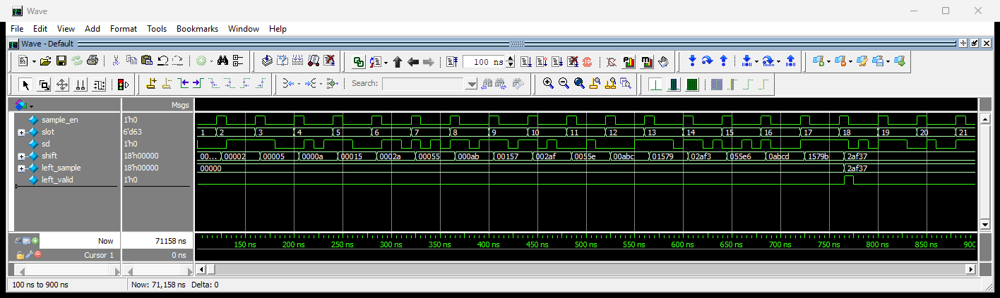

## Overview

The FPGA handles the audio work that has to keep up with the microphone in
real time. It reads samples from the SPH0645 microphone over I2S, adds each
group of 3 samples, removes the DC offset, stores the samples in a ring buffer,
runs a 512-point FFT every 20 ms, and sends the result to the MCU over SPI.

## Block Diagram

::: {.column-page}
{#fig-fpga-top fig-alt="Block diagram of fpga_top. The SPH0645 microphone sits outside the FPGA on the left: the FPGA sends it bclk and ws, and it sends back sd. Inside fpga_top the blocks run left to right: u_i2s_receiver, u_sum_of_3, u_dc_removal, u_ring_buffer, u_fft_controller with the 512-point fft, and u_spi_frame_tx. sample[17:0] and sample_valid, sum[19:0] and sum_valid, and pcm[15:0] and pcm_valid pass between the first four. The ring buffer sends read_data[15:0] and frame_ready to the FFT controller, which returns read_index[8:0]. The FFT controller sends bin_we, bin_addr[7:0], bin_data[31:0], bins_done and frame_num[7:0] to the SPI driver, which drives spi_sck, spi_mosi and spi_cs_b to the MCU. u_hsosc makes the 12 MHz clk; clk and reset_b go to every block."}
:::

[](https://github.com/GabeAlencar/AVIPEe155/blob/main/docs/blockDiagrams/fpga_top.circuitpaint.json)

## fpga_top {#mod-top}

fpga_top.sv connects the four finished blocks in a chain. Each block hands the next one a
value and a one-clock valid strobe, so the whole chain runs on one clock.

| Module | What it does |
|---|---|
| [i2s_receiver ](#mod-receiver)  | Drives bclk and ws and reads 18-bit samples from the microphone. |
| [sum_of_3](#mod-sum3) | Adds each group of 3 samples into one 20-bit sum. |
| [dc_removal](#mod-dc)  | Subtracts a running average and saturates to 16 bits. |
| [ring_buffer](#mod-ring)| Keeps the last 512 samples in block RAM and starts a new frame every 312 samples. |

: Modules inside fpga_top

| Signal | Width | Rate | Between |
|---|---|---|---|
| bclk, ws, sd | 1 bit each | 3 MHz, 46.875 kHz | microphone and i2s_receiver |
| sample, sample_valid | 18 bits | 46.875 kHz | i2s_receiver and sum_of_3 |
| sum, sum_valid | 20 bits | 15.625 kHz | sum_of_3 and dc_removal |
| pcm, pcm_valid | 16 bits | 15.625 kHz | dc_removal and ring_buffer |
| frame_ready | 1 bit | every 312 samples | ring_buffer and the outputs (FFT next) |
| read_index, read_data | 9 bits in, 16 bits out | up to one per clk | the inputs and ring_buffer |

: Signals along the chain

{fig-alt="Questa waveform from 39.921 to 39.966 ms. frame_ready pulses once at the left. read_index is an analog ramp from 0 to 511. read_data is an analog tone of about 33 cycles whose center drifts slowly upward."}


::: {.callout-note collapse="true" title="Fpga_top.sv source code"}
```{.systemverilog filename="fpga/src/fpga_top.sv" include="../fpga/src/fpga_top.sv"}
```
:::

### i2s_receiver {#mod-receiver}

The I2S receiver turns the microphone's serial data into one 18-bit two's
complement sample per frame. The FPGA is the I2S master: it makes the bit clock
(`bclk`) and word select (`ws`) from its 12 MHz clock, and the microphone sends
data on `sd` in time with them. The microphone's SEL pin is tied to GND, so it
sends on the left channel, while `ws` is low.

| Signal | Rate | How it is made |
|---|---|---|
| clk | 12 MHz | iCE40 internal HSOSC, 48 MHz / 4 (fpga_board_top) |
| bclk | 3 MHz | 12 MHz / 4 |
| ws | 46.875 kHz | 3 MHz / 64, so each frame is 64 bclk periods |
| sample | 46.875 kHz | One 18-bit word per frame, with a one-clock sample_valid strobe |

: I2S receiver clocks and rates

| Module | What it does |
|---|---|
| [i2s_clkgen](#mod-clkgen) | Makes bclk and ws, and tells the deserializer when to read sd (sample_en) and which bit it is (slot). |
| [counter](#mod-counter) | Enabled up-counter that wraps at MAX, reused from Lab 3. i2s_clkgen uses two of them. |
| [i2s_deserializer](#mod-deserializer) | Shifts in bits 1 to 18 of the left channel, MSB first, and outputs the finished word. |

: Modules inside i2s_receiver

`i2s_receiver` has two parameters. `DATA_WIDTH` (default 18) sets how many bits
are kept from each word, starting at the MSB. `CHANNEL` (default 0) picks the
left or right channel.

#### Reading a word

Each half frame is 32 `bclk` periods, called slots. `ws` falls at the start of
slot 0. The microphone sees the new `ws` on the next rising edge of `bclk` and
sends the MSB 7 to 66 ns after it, then one bit after each rising edge: 18
data bits, then 6 zeros. The receiver reads each bit one `clk` after `bclk`
falls, at the start of the next slot, so the MSB is read in slot 1 and the last
data bit in slot 18. See the [SPH0645 microphone](#mod-mic) for the timing.

{fig-alt="Questa waveform of clk, bclk, ws, sd, sample_en, slot, and the shift register from 42.6 to 44.45 microseconds. ws falls as slot goes from 63 to 0. sample_en pulses once per bclk period, in the clk cycle after bclk falls, and the shift register changes from 13462 to 268C4, 0D189, 1A313, and 34627 on those pulses. sd changes shortly after each bclk rising edge, with short red unknown sections."}

{fig-alt="Questa waveform of bclk, ws, sd, sample, and sample_valid from 43 to 65.5 microseconds. sd is high for 17 bits while ws is low, with short red unknown marks after each bclk rise, then dashed while the microphone leaves it undriven. sample changes from 13462 to 1FFFF when sample_valid pulses."}

In these screenshots, the short red marks on `sd` are where the microphone model
drives an unknown value between 7 ns and 40 ns after each `bclk` rise, the
window where the datasheet allows the data to change. The dashed sections are
`sd` pulled low while the microphone leaves it undriven.

#### Why there is no synchronizer on `sd`

`sd` comes from outside the FPGA, but it is not asynchronous. The FPGA drives
`bclk`, so `sd` only changes at a known time, just after `bclk` rises, and is
stable for at least 90 ns on either side of the `clk` edge that reads it. A
two-flop synchronizer would only add 2 cycles of delay without making the read
any safer.

::: {.callout-note collapse="true" title="i2s_receiver_tb: full receiver with a microphone model"}
[i2s_receiver_tb.sv](https://github.com/GabeAlencar/AVIPEe155/blob/main/fpga/sim/i2s_receiver_tb.sv)
runs the whole receiver at the real 12 MHz clock against a model of the
SPH0645 that follows the datasheet timing. The model reads `ws` on each rising
edge of `bclk`, holds the old bit for 7 ns, drives an unknown value until the
data delay, then drives the new bit. It sends an 18-bit word followed by 6
zeros, starting at the first rising edge after `ws` falls, and leaves `sd`
undriven otherwise. Every word the model sends must come out of the receiver
once, in order.

It checks:

- Reset holds `bclk`, `ws`, and `sample` low.
- `bclk` is 3 MHz and `ws` is 46.875 kHz with a 50% duty cycle.
- Corner values (largest positive, most negative, -1, 0, alternating bits, only
  the LSB) and random words all come through, with `sd` changing 7 ns (the
  datasheet's minimum hold), 40 ns, and 66 ns (the datasheet's maximum delay)
  after `bclk` rises.
- Random data on the right channel is ignored.
- `sample_valid` pulses once every 256 `clk` cycles, and `ws` only changes when
  `bclk` falls.
- A reset in the middle of a word clears the outputs, and the receiver works
  again afterward.

Times are in ps.

```
PASSED! Reset holds bclk, ws, and sample low at time: 200000.
PASSED! bclk period is 333.3 ns (3 MHz) at time: 708000.
PASSED! ws period is 21333.5 ns (46.875 kHz), low for 10666.8 ns at time: 42875000.
PASSED! 51 words received correctly, 40 ns data delay at time: 1094300000.
PASSED! 50 words received correctly, 7 ns data delay at time: 2160976000.
PASSED! 50 words received correctly, 66 ns data delay at time: 3227651000.
PASSED! Right channel data is ignored at time: 4294326000.
PASSED! sample_valid pulses once every 256 clk (46.875 kHz) at time: 4294326000.
PASSED! ws changes only when bclk falls at time: 4294326000.
PASSED! Asynchronous reset in the middle of a word clears the outputs at time: 4297670000.
PASSED! Words received correctly after reset at time: 4496244000.
ALL TESTS PASSED
```
:::

::: {.callout-note collapse="true" title="I2s_receiver.sv source code"}
```{.systemverilog filename="fpga/src/i2s_receiver.sv" include="../fpga/src/i2s_receiver.sv"}
```
:::

#### SPH0645 microphone interface {#mod-mic}

The receiver was checked against the Knowles SPH0645LM4H-B datasheet (Rev B).

| Requirement | Datasheet | This design |
|---|---|---|
| bclk frequency | 2.048 to 4.096 MHz | 3 MHz |
| bclk high and low time | at least 85.45 ns | 166.7 ns each |
| ws rate | bclk / 64 | bclk / 64 = 46.875 kHz |
| ws changes on | the falling edge of bclk | the falling edge of bclk |
| ws setup and hold | at least 85.45 ns | 166.7 ns |
| Sample rate | 32 to 64 kHz | 46.875 kHz |
| MSB position | 1 bclk after ws changes | read in slot 1 |
| Word format | 24 bits, 18-bit precision, two's complement, MSB first | keeps the top 18 bits |
| SEL low | drives sd while ws is low | left channel |
| sd changes | 7 to 65.92 ns after bclk rises | read 250 ns after the rise |

: SPH0645 requirements

The datasheet's timing diagram has the microphone change `sd` after the
**rising** edge of `bclk`, which is half a period earlier than a standard I2S
transmitter. The receiver reads `sd` one `clk` after `bclk` falls, 250 ns
after the rise that sent the bit. That leaves 184 ns of setup after the latest
change and 90 ns of hold before the next one, so delays in the FPGA pins and
wires still leave plenty of margin.

{fig-alt="Questa waveform of clk, bclk, ws, sd, sample_en, slot, and the shift register from 42.6 to 43.45 microseconds. ws falls as slot goes from 63 to 0. sd is driven after the following bclk rise. sample_en pulses in the clk cycle after bclk falls, and the shift register changes from 13462 to 268C4 when slot is 1."}

An earlier version of `i2s_clkgen` assumed the microphone changes `sd` after
`bclk` falls, so it read `sd` 83 ns after `bclk` rose. With the datasheet
timing, that read gets the next bit, so every word would come out shifted left
by one bit and lose its sign bit. The current microphone model in
`i2s_receiver_tb` follows the datasheet and fails on that version, turning
`1FFFF` into `3FFFE` and `20000` into `00000`.

Two board-level notes from the datasheet:

- With one microphone on the bus, put a 100 kΩ pull-down resistor from `sd` to
  ground so the line settles low while the microphone is not driving it.
- The microphone needs up to 50 ms after power-up before its data is valid, so
  the samples from that time should be ignored. Nothing in the FPGA does this
  yet, and the DC removal also needs about 0.3 s to settle on the offset.

#### i2s_clkgen {#mod-clkgen}

`i2s_clkgen` makes the two I2S clocks from the 12 MHz `clk` and tells the
deserializer when to read `sd`. One counter, `phase`, counts the 4 `clk`
cycles in each `bclk` period. The other, `bit_cnt`, counts the 64 `bclk`
periods in each frame and only advances when `phase` wraps from 3 to 0.

- `bclk = phase[1]`, so `bclk` is low for phases 0 and 1 and high for phases 2 and 3.
- `ws = bit_cnt[5]`, so `ws` is low for slots 0 to 31 (left) and high for 32 to 63 (right).
- `bit_cnt` advances on the same `clk` edge that makes `bclk` fall, so `ws`
  always changes on a falling edge of `bclk`, as the microphone requires.
- `sample_en` is high when `phase == 0`, so the deserializer reads `sd` on the
  `clk` edge where `phase` becomes 1, one `clk` after `bclk` falls.
- `slot` is `bit_cnt`, the slot being read.

| phase | 0 | 1 | 2 | 3 |
|---|---|---|---|---|
| bclk | 0 | 0 | 1 | 1 |
| sample_en | 1 | 0 | 0 | 0 |
| What happens | bclk just fell; sd is read at the end of this phase | | bclk just rose; the microphone changes sd 7 to 66 ns later | bit_cnt advances at the end of this phase |

: One bclk period

The microphone changes `sd` 7 to 66 ns after each rising edge of `bclk`. The
read is 250 ns after the rise that sent the bit, so `sd` has been stable for at
least 184 ns and stays stable for at least 90 ns more.

![The clock generator after reset. phase counts 0 to 3, bclk is phase[1], and sample_en pulses in phase 0, the cycle after bclk falls.](images/fpga/i2s_clkgen_start.png){fig-alt="Questa waveform of clk, reset_b, phase, bclk, sample_en, slot, and ws from 0 to 420 ns. After reset_b rises, phase counts 0 to 3 repeatedly, bclk is high for phases 2 and 3, sample_en pulses once per bclk period during phase 0, and slot counts up from 0."}

{fig-alt="Questa waveform of clk, phase, bclk, sample_en, slot, and ws from 1140 to 1470 ns. ws rises at the same time bclk falls, as slot goes from 31 to 32, and sample_en pulses in the following clk cycle."}

::: {.callout-note collapse="true" title="i2s_clkgen_tb: bclk, ws, and bit timing"}
[i2s_clkgen_tb.sv](https://github.com/GabeAlencar/AVIPEe155/blob/main/fpga/sim/i2s_clkgen_tb.sv)
watches the clock generator every cycle for 4 full frames.

It checks:

- Reset holds `bclk` and `ws` low and starts in slot 0.
- `bclk` rises 2 cycles after reset, then is high and low for 2 cycles each.
- `sample_en` pulses exactly once per `bclk` period, in the cycle after `bclk` falls.
- `slot` steps by one each `bclk` period, and is 0 when `ws` falls and 32 when it rises.
- `ws` changes only when `bclk` falls and holds for 32 `bclk` periods.
- An asynchronous reset clears `bclk` and `ws` between clock edges.

Times are in ns.

```
PASSED! Reset holds bclk and ws low at time: 22.
PASSED! Reset starts in slot 0 at time: 22.
PASSED! bclk still low 1 clk after reset at time: 36.
PASSED! bclk rises 2 clk after reset at time: 46.
PASSED! bclk high and low for 2 clk each (256 falls) at time: 10290.
PASSED! sample_en pulses once after each bclk fall (256 pulses) at time: 10290.
PASSED! slot steps by one each bclk period at time: 10290.
PASSED! ws changes only when bclk falls (8 edges) at time: 10290.
PASSED! ws holds for 32 bclk periods at time: 10290.
PASSED! slot is 0 when ws falls and 32 when ws rises at time: 10290.
PASSED! Asynchronous reset clears bclk and ws at time: 11578.
ALL TESTS PASSED
```
:::

::: {.callout-note collapse="true" title="I2s_clkgen.sv source code"}
```{.systemverilog filename="fpga/src/i2s_clkgen.sv" include="../fpga/src/i2s_clkgen.sv"}
```
:::

##### counter {#mod-counter}

[`counter.sv`](https://github.com/GabeAlencar/AVIPEe155/blob/main/fpga/src/counter.sv)
counts up by one on each `clk` edge where `enable` is high, and wraps from `MAX`
back to 0. `WIDTH` sets the number of bits. In [`i2s_clkgen`](#mod-clkgen),
`phase` uses `WIDTH = 2`, `MAX = 3` with `enable` tied high, and `bit_cnt` uses
`WIDTH = 6`, `MAX = 63`, enabled once per `bclk` period. In
[`sum_of_3`](#mod-sum3), `sample_count` uses `WIDTH = 2`, `MAX = 2`, enabled by
`sample_valid`. In [`ring_buffer`](#mod-ring), `write_addr` uses `WIDTH = 9`,
`MAX = 511` and `hop_count` uses `WIDTH = 9`, `MAX = 311`, both enabled by
`pcm_valid`.

{fig-alt="Questa waveform of clk, reset_b, enable, and count from 0 to 240 ns. count steps 1 through 9, wraps to 0, steps to 3, holds at 3 while enable is low, and returns to 0 when reset_b falls."}

::: {.callout-note collapse="true" title="counter_tb: the Lab 3 counter"}
[counter_tb.sv](https://github.com/GabeAlencar/AVIPEe155/blob/main/fpga/sim/counter_tb.sv)
tests the counter with `WIDTH = 4` and `MAX = 9`.

It checks:

- Reset holds `count` at 0.
- `count` holds while `enable` is low and steps by one on each enabled edge.
- `count` wraps from `MAX` back to 0.
- An asynchronous reset clears `count` between clock edges.

Times are in ns.

```
PASSED! Reset holds count at 0: count = 0 at time: 22.
PASSED! Count holds while disabled: count = 0 at time: 56.
PASSED! Count steps by one: count = 1 at time: 66.
PASSED! Count steps by one: count = 2 at time: 76.
PASSED! Count steps by one: count = 3 at time: 86.
PASSED! Count steps by one: count = 4 at time: 96.
PASSED! Count steps by one: count = 5 at time: 106.
PASSED! Count steps by one: count = 6 at time: 116.
PASSED! Count steps by one: count = 7 at time: 126.
PASSED! Count steps by one: count = 8 at time: 136.
PASSED! Count steps by one: count = 9 at time: 146.
PASSED! Count wraps after MAX: count = 0 at time: 156.
PASSED! Count holds mid-count: count = 3 at time: 226.
PASSED! Asynchronous reset clears count: count = 0 at time: 233.
ALL TESTS PASSED
```
:::

::: {.callout-note collapse="true" title="Counter.sv source code"}
```{.systemverilog filename="fpga/src/counter.sv" include="../fpga/src/counter.sv"}
```
:::

#### i2s_deserializer {#mod-deserializer}

[`i2s_deserializer.sv`](https://github.com/GabeAlencar/AVIPEe155/blob/main/fpga/src/i2s_deserializer.sv)
shifts in one channel of I2S data, MSB first. It shifts on `clk` edges where
`sample_en` is high, `slot` is in its channel's half of the frame (`slot[5]`
equals `CHANNEL`), and the slot within that half is 1 to `DATA_WIDTH`. The
SPH0645 sends 18 bits of data in a 24-bit word, so `DATA_WIDTH = 18` keeps
every bit that carries data.

When the last bit is read, the finished word goes into the `sample` register
and `sample_valid` is high for one `clk`. `sample` then holds that value until
the next word, one frame later.

{fig-alt="Questa waveform of sample_en, slot, sd, the left shift register, left_sample, and left_valid from 100 to 900 ns. sd toggles randomly between reads, slots count 1 to 21, the shift register builds up 2AF37 one bit at a time, and left_sample changes from 00000 to 2AF37 when left_valid pulses after slot 18."}

::: {.callout-note collapse="true" title="i2s_deserializer_tb: shifting in each channel"}
[i2s_deserializer_tb.sv](https://github.com/GabeAlencar/AVIPEe155/blob/main/fpga/sim/i2s_deserializer_tb.sv)
drives `slot` and `sample_en` directly, with two deserializers sharing the
inputs, one for each channel. `sd` takes random values whenever it should not be
read, so a word only comes through if each bit is read at the right time.

It checks:

- Reset clears `sample` and `sample_valid`.
- Each channel keeps only its own word: different words on each channel,
  largest positive and most negative, 0 and -1, alternating bits (which would
  catch a one-bit shift), and 20 random words.
- `sample_valid` lasts exactly one clock.
- `sample` holds its value when `sample_en` stays low.
- An asynchronous reset clears `sample` between clock edges.

Times are in ns.

```
PASSED! Reset clears sample and sample_valid at time: 22.
PASSED! Different words on each channel: left 2af37 right 048d1 at time: 2596.
PASSED! Largest positive and most negative: left 1ffff right 20000 at time: 5156.
PASSED! Most negative and largest positive: left 20000 right 1ffff at time: 7716.
PASSED! Zero and -1: left 00000 right 3ffff at time: 10276.
PASSED! Alternating bits: left 2aaaa right 15555 at time: 12836.
PASSED! Random words: left 2fdaa right 381e0 at time: 15396.
PASSED! Random words: left 3d3b3 right 144fc at time: 17956.
PASSED! Random words: left 2776b right 0c9b5 at time: 20516.
PASSED! Random words: left 3d423 right 23553 at time: 23076.
PASSED! Random words: left 36317 right 0ed87 at time: 25636.
PASSED! Random words: left 3f8d2 right 3ca0d at time: 28196.
PASSED! Random words: left 3d7e2 right 1383b at time: 30756.
PASSED! Random words: left 37c64 right 078d5 at time: 33316.
PASSED! Random words: left 3abb7 right 13559 at time: 35876.
PASSED! Random words: left 06b43 right 34fc0 at time: 38436.
PASSED! Random words: left 362c3 right 31a33 at time: 40996.
PASSED! Random words: left 113e1 right 1898c at time: 43556.
PASSED! Random words: left 05a1d right 276e4 at time: 46116.
PASSED! Random words: left 01cfb right 048e3 at time: 48676.
PASSED! Random words: left 0e106 right 11e10 at time: 51236.
PASSED! Random words: left 3f513 right 274af at time: 53796.
PASSED! Random words: left 30bf7 right 1ec03 at time: 56356.
PASSED! Random words: left 06b88 right 39b0e at time: 58916.
PASSED! Random words: left 2715d right 19d3a at time: 61476.
PASSED! Random words: left 15051 right 02ccc at time: 64036.
PASSED! sample_valid lasts exactly one clk at time: 64036.
PASSED! Known words before the hold test: left 03c3c right 3c3c3 at time: 66596.
PASSED! Sample holds while sample_en is low at time: 68596.
PASSED! Asynchronous reset clears sample at time: 71158.
ALL TESTS PASSED
```
:::

::: {.callout-note collapse="true" title="I2s_deserializer.sv source code"}
```{.systemverilog filename="fpga/src/i2s_deserializer.sv" include="../fpga/src/i2s_deserializer.sv"}
```
:::

### sum_of_3 {#mod-sum3}

[`sum_of_3.sv`](https://github.com/GabeAlencar/AVIPEe155/blob/main/fpga/src/sum_of_3.sv)
takes each 18-bit `sample` from the I2S receiver when `sample_valid` pulses,
adds each group of 3, and outputs one 20-bit `sum` with a one-clock
`sum_valid` strobe. This drops the sample rate from 46.875 kHz to
15.625 kHz, so a 512-point FFT covers 32.8 ms of sound with 30.5 Hz bins up
to 7.8 kHz.

| Signal | Width | Rate |
|---|---|---|
| sample (in) | 18 bits, two's complement | 46.875 kHz, with sample_valid |
| sum (out) | 20 bits, two's complement | 15.625 kHz, with sum_valid |

: sum_of_3 inputs and outputs

#### How it adds

The [`counter`](#mod-counter) `sample_count` steps 0, 1, 2 on each `sample_valid`
and then wraps, so it says which sample of the group is arriving. On a valid
sample:

- If `sample_count` is 0, `partial_sum` loads the sample, which starts a new
  group without a separate clear step.
- Otherwise `partial_sum` adds the sample to the sum so far.
- If `sample_count` is 2 (`last_sample`), the finished sum goes into the
  output register and `sum_valid` pulses one `clk` later.

Because the output register loads `partial_sum + sample` directly, samples can
arrive on back-to-back clock cycles. The receiver only sends one every 256
`clk`, so the block has plenty of time. Reset clears `sample_count`, so the
first sample after reset starts a group.

The sum is 2 bits wider than a sample. Each sample is sign-extended by copying
its MSB into the 2 new bits, and the extremes fit with room to spare:
3 × 131071 = 393213 and 3 × −131072 = −393216, inside the 20-bit range of
−524288 to 524287. The block keeps the sum instead of dividing by 3, since the
sum is just 3 times the average and dividing would cost extra logic.

{fig-alt="Questa waveform of clk, sample_valid, sample, sample_count, partial_sum, sum, and sum_valid from 160 ns to 1 microsecond. sample_count steps 0, 1, 2 on each sample_valid pulse. partial_sum shows 6 then 5, -2, -1, then -100, -300, -600, then 131071, 262142, 393213, then -131072, -262144, -393216. sum changes to -1, -600, 393213, and -393216, each with a one-cycle sum_valid pulse."}

#### Filtering

Adding 3 samples and keeping one sum is a simple low-pass filter followed by
keeping every third result. Its gain is
$|H(f)| = \left|\frac{\sin(3\pi f / f_s)}{\sin(\pi f / f_s)}\right|$
with $f_s$ = 46.875 kHz. That is 3 at DC and 2 at 7.8 kHz, the top of the
output band, so high notes are only 3.5 dB lower. It has zeros at 15.625 kHz
and 31.25 kHz, the frequencies that would fold onto DC. Sound between 7.8 and
15.6 kHz is only partly reduced (for example 6 dB at 10 kHz) and can still
fold into the band, so that is a limit of this simple filter.

::: {.callout-note collapse="true" title="sum_of_3_tb: groups, extremes, and a model check"}
[sum_of_3_tb.sv](https://github.com/GabeAlencar/AVIPEe155/blob/main/fpga/sim/sum_of_3_tb.sv)
stands in for the receiver. It sends samples with a one-clock `sample_valid`
pulse and puts random values on `sample` between pulses. A model in the
testbench keeps its own sum of each group, and a monitor checks every
`sum_valid` pulse against it.

It checks:

- Reset clears `sum` and `sum_valid`.
- Small, mixed-sign, and all-negative groups.
- 3 times the largest and most negative samples, which need the 2 extra bits.
- No `sum_valid` after only 2 samples, and the old `sum` holds.
- Samples on 3 clock cycles in a row.
- 30 random samples at the real rate (one every 256 `clk`) and 300 with random
  gaps of 0 to 12 `clk`, all matching the model.
- `sum_valid` lasts exactly one `clk`.
- An asynchronous reset in the middle of a group clears `sum`, and the next
  group ignores the samples from before the reset.

A copy of the module with the sign extension replaced by zeros fails 8 of
these checks.

Times are in ns.

```
PASSED! Reset clears sum and sum_valid at time: 22.
PASSED! Small positive samples: 1 + 2 + 3 = 6 at time: 216.
PASSED! Mixed signs give -1: 5 + -7 + 1 = -1 at time: 396.
PASSED! All negative: -100 + -200 + -300 = -600 at time: 576.
PASSED! 3 x largest positive: 131071 + 131071 + 131071 = 393213 at time: 756.
PASSED! 3 x most negative: -131072 + -131072 + -131072 = -393216 at time: 936.
PASSED! Largest and most negative cancel to -1: 131071 + -131072 + 0 = -1 at time: 1116.
PASSED! No sum after only 2 of a group; old sum holds at time: 1236.
PASSED! Third sample finishes the group at time: 1296.
PASSED! Samples on 3 clk in a row: 1000 + -2000 + 3000 = 2000 at time: 1356.
PASSED! Every sum matches the model (118 sums) at time: 101305.
PASSED! sum_valid lasts exactly one clk at time: 101305.
PASSED! Asynchronous reset clears sum at time: 101428.
PASSED! Group after reset ignores samples before it: -1 + -2 + -3 = -6 at time: 101616.
ALL TESTS PASSED
```
:::

::: {.callout-note collapse="true" title="Sum_of_3.sv source code"}
```{.systemverilog filename="fpga/src/sum_of_3.sv" include="../fpga/src/sum_of_3.sv"}
```
:::

### dc_removal {#mod-dc}

[`dc_removal.sv`](https://github.com/GabeAlencar/AVIPEe155/blob/main/fpga/src/dc_removal.sv)
takes each 20-bit `sum` from [`sum_of_3`](#mod-sum3) when `sum_valid` pulses,
subtracts a slow running average to remove the microphone's DC offset, and
outputs a 16-bit `pcm` sample with a one-clock `pcm_valid` strobe. A DC offset
would put a large spike in the FFT's first bin and use up range the sound
needs, so it comes out before the ring buffer.

| Signal | Width | Rate |
|---|---|---|
| sum (in) | 20 bits, two's complement | 15.625 kHz, with sum_valid |
| pcm (out) | 16 bits, two's complement | 15.625 kHz, with pcm_valid |

: dc_removal inputs and outputs

#### Running average

On each `sum_valid`, the average moves 1/1024 of the way toward the new sum:

$$\text{average} \leftarrow \text{average} + \frac{\text{sum} - \text{average}}{1024}$$

Dividing by 1024 is a shift, so the block needs no multiplier. To keep the
small steps from being rounded away, `average_acc` holds the average times
1024, which is 10 extra fraction bits (31 bits in all). Each valid sum does:

- `average` = `average_acc >>> 10`, the whole part of the average.
- `difference` = `sum − average`, the sample with the DC removed.
- `average_acc` ← `average_acc + sum − average`.

The output uses the average from before the update. The first sum after reset
passes through unchanged, since the average starts at 0.

The shift is set by `AVERAGE_SHIFT = 10`. At 15.625 kHz that gives a time
constant of 1024 samples (65.5 ms), so after a change in the offset, 37% is
left after 65.5 ms and about 1% after 0.3 s. The cutoff is 2.4 Hz, far below
the FFT's first 30.5 Hz bin, so even the lowest notes pass. The average rounds
down, but once the input holds still, `average` equals the input exactly and
the output settles at 0.

{fig-alt="Questa analog waveform of average and pcm from 0 to 410 microseconds. average curves up from 0 and levels off. pcm is a dense tone whose center starts high and drifts down until it is centered on 0."}

The simulation sends a sum every 4 `clk` instead of every 768, so the figure
shows in 410 µs what takes about 0.66 s in hardware.

#### Saturating to 16 bits

`difference` can be up to 21 bits, but the ring buffer and FFT use 16-bit
samples. The block keeps the low 16 bits and clamps anything outside the
16-bit range to 32767 or −32768, so a loud sound clips instead of wrapping
around to the opposite sign. Keeping the low bits instead of the top bits is
the gain from the proposal. Compared with one 18-bit sample cut down to 16 bits
by dropping its 2 lowest bits, the output is 12 times larger: 3 from the sum
and 4 from keeping the low bits. That lifts speech at 65 dB SPL well above the
bottom bits, and sound above about 98 dB SPL clips.

{fig-alt="Questa waveform of clk, sum_valid, sum, average_acc, average, pcm, and pcm_valid. Three sum_valid pulses read 393213, -393216, and 12767. pcm becomes 32767, -32768, and 32728, and average steps from -20000 to -19596, -19961, and -19929."}

::: {.callout-note collapse="true" title="dc_removal_tb: offset, tone, saturation, and a model check"}
[dc_removal_tb.sv](https://github.com/GabeAlencar/AVIPEe155/blob/main/fpga/sim/dc_removal_tb.sv)
stands in for `sum_of_3`. It sends sums with a one-clock `sum_valid` pulse
and puts random values on `sum` between pulses. A model in the testbench runs
the same running average, and a monitor checks every `pcm_valid` pulse
against it.

It checks:

- Reset clears `pcm` and `pcm_valid`, and the first sum passes through.
- A 500 Hz tone on a DC offset of 20000: after 8 time constants the output
  swings from about −8000 to 8000, so the offset is gone and the tone is not.
- An input of 0 settles to exactly 0.
- A step of 5000 passes at first, falls to 5000/e after 1024 samples, and
  settles to exactly 0. A negative offset also settles to 0.
- The largest and most negative sums clamp to 32767 and −32768, and a value
  just under the limit does not clamp.
- 4000 random sums with random gaps, small and full range, plus 10 at the real
  rate (one every 768 `clk`). All 50230 outputs in the test match the model.
- `pcm_valid` lasts exactly one `clk`.
- An asynchronous reset clears `pcm`, and the average restarts at 0.

A copy of the module without the clamp fails 3 of these checks.

Times are in ns.

```
PASSED! Reset clears pcm and pcm_valid at time: 22.
PASSED! First sum passes through: pcm = 1234 at time: 96.
PASSED! Tone on a DC offset: DC removed, output from -7995 to 8019 at time: 409696.
PASSED! Input of 0 settles to exactly 0: pcm = 0 at time: 649696.
PASSED! Step of +5000 passes at first: pcm = 5000 at time: 649716.
PASSED! After 1024 samples it is near 5000/e = 1839: pcm = 1840 at time: 670176.
PASSED! Settles to exactly 0: pcm = 0 at time: 890176.
PASSED! Negative offset settles to 0: pcm = 0 at time: 1170176.
PASSED! Largest sum clamps to 32767: pcm = 32767 at time: 1170236.
PASSED! Most negative sum clamps to -32768: pcm = -32768 at time: 1170296.
PASSED! Just under the limit does not clamp: pcm = 32728 at time: 1170356.
PASSED! Every output matches the model (50230 outputs) at time: 1448875.
PASSED! pcm_valid lasts exactly one clk at time: 1448875.
PASSED! Asynchronous reset clears pcm at time: 1448938.
PASSED! Average restarts at 0 after reset: pcm = -777 at time: 1449006.
ALL TESTS PASSED
```
:::

::: {.callout-note collapse="true" title="Dc_removal.sv source code"}
```{.systemverilog filename="fpga/src/dc_removal.sv" include="../fpga/src/dc_removal.sv"}
```
:::

### ring_buffer {#mod-ring}

[`ring_buffer.sv`](https://github.com/GabeAlencar/AVIPEe155/blob/main/fpga/src/ring_buffer.sv)
stores every `pcm` sample from [`dc_removal`](#mod-dc) in a 512 × 16 block RAM,
overwriting the oldest one, so it always holds the last 512 samples
(32.8 ms). Every 312 samples (20 ms) it pulses `frame_ready` for one `clk`.
The FFT frame copy then reads the frame through `read_index`, oldest first, so
it sees a new 512-sample window every 20 ms, overlapping the last one by 200
samples.

| Signal | Width | What it is |
|---|---|---|
| pcm, pcm_valid (in) | 16 bits | one sample every 768 clk (15.625 kHz) |
| frame_ready (out) | 1 bit | one-clk pulse every 312 samples, once 512 are stored |
| read_index (in) | 9 bits | 0 is the oldest sample of the frame, 511 the newest |
| read_data (out) | 16 bits | the sample at read_index, one clk later |

: ring_buffer inputs and outputs

#### How it works

- The [`counter`](#mod-counter) `write_addr` (0 to 511) steps on each
  `pcm_valid`, and the RAM writes `pcm` there on the same edge.
- The [`counter`](#mod-counter) `hop_count` (0 to 311) also steps on each
  `pcm_valid`. On the 312th sample of each hop, if the buffer has filled,
  `frame_ready` pulses one `clk` later.
- On that same sample, `frame_start` saves `write_addr + 1`: the address after
  the newest sample holds the oldest one still kept. The read address is
  `frame_start + read_index`, which wraps around the end of the RAM by itself
  since both are 9 bits.
- A `filled` flag sets once all 512 addresses have been written, so no frame
  comes out with stale RAM contents after reset. The first frame comes at 624
  samples, the first hop boundary after 512.

The RAM has one write port and one read port, so the frame can be read while
new samples are written. The next sample after `frame_ready` overwrites the
oldest sample of the frame (`read_index` 0), but not until 767 `clk` after
`frame_ready`. A reader that asks for `read_index` 0 less than 767 `clk` after
`frame_ready` always gets the whole frame before anything in it changes. Reading all 512 takes 512 `clk`.

{fig-alt="Questa waveform of clk, pcm_valid, pcm, write_addr, hop_count, filled, frame_ready, frame_start, read_index, and read_data from 24.88 to 25.08 microseconds. write_addr steps 110, 111, 112 and hop_count steps 310, 311, 0 on pcm_valid pulses. frame_ready pulses for one clk and frame_start changes from 312 to 112. read_index counts 0, 1, 2 and read_data follows one clk later with A570, A571, A572."}

::: {.callout-note collapse="true" title="ring_buffer_tb: frames, overlap, and reading while writing"}
[ring_buffer_tb.sv](https://github.com/GabeAlencar/AVIPEe155/blob/main/fpga/sim/ring_buffer_tb.sv)
stands in for `dc_removal` on the write side and for the FFT frame copy on the
read side. It keeps a list of every sample sent. On each `frame_ready` it
reads `read_index` 0 to 511 and checks that they are the last 512 samples
sent, oldest first. Between `pcm_valid` pulses, `pcm` changes to random
values.

It checks:

- Reset clears `frame_ready`.
- No `frame_ready` in the first 623 samples, then one at 624.
- Frames 1 and 2 are the last 512 samples, 312 samples apart.
- A frame reads correctly while 2 new samples are written over its oldest
  addresses during the read.
- 6 more frames with random gaps between samples, with the write pointer
  wrapping many times.
- `frame_ready` lasts one `clk`, comes every 312 samples, and never before
  the buffer is full.
- An asynchronous reset clears `frame_ready`, the buffer must refill before
  the next frame, and that frame is correct.

Copies of the module with `frame_start` one address early, or without the
`filled` check, fail 5 of these checks each.

Times are in ns.

```
PASSED! Reset clears frame_ready at time: 22.
PASSED! No frame_ready in the first 623 samples at time: 24950.
PASSED! First frame_ready after 624 samples at time: 24990.
PASSED! Frame 1 is samples 112 to 623, oldest first at time: 30116.
PASSED! Frame 2 after 936 samples, 312 after frame 1 at time: 42596.
PASSED! Frame 2 is the latest 512 samples at time: 47716.
PASSED! Frame read correctly while 2 new samples were written at time: 681990.
PASSED! 6 more frames read correctly, 9 frames in all at time: 787166.
PASSED! frame_ready lasts exactly one clk at time: 787166.
PASSED! frame_ready every 312 samples once the buffer is full at time: 787166.
PASSED! Asynchronous reset clears frame_ready at time: 787208.
PASSED! No frame_ready until the buffer refills at time: 799670.
PASSED! First frame after reset is correct at time: 804816.
ALL TESTS PASSED
```
:::

::: {.callout-note collapse="true" title="Ring_buffer.sv source code"}
```{.systemverilog filename="fpga/src/ring_buffer.sv" include="../fpga/src/ring_buffer.sv"}
```
:::

#### dual_port_ram {#mod-ram}

[`dual_port_ram.sv`](https://github.com/GabeAlencar/AVIPEe155/blob/main/fpga/src/dual_port_ram.sv)
is written like `sbox_sync` from Lab 7: the memory is an array, and the read
happens inside `always_ff`, so `read_data` is a register. A synchronous read
is what lets Radiant build the memory from block RAM instead of logic cells.
Each UP5K EBR block holds 256 × 16 bits, so 512 × 16 takes 2 of the 30
blocks, and the synthesis report confirms 2 EBRs. The RAM has no reset
because a reset cannot clear block RAM contents, which is why
[`ring_buffer`](#mod-ring) waits until all 512 addresses are written before its
first frame.

| Port | Width | What it does |
|---|---|---|
| write_en, write_addr, write_data | 1, 9, 16 bits | writes write_data at write_addr on each clk edge where write_en is high |
| read_addr, read_data | 9, 16 bits | read_data is the word at read_addr one clk later |

: dual_port_ram ports

::: {.callout-note collapse="true" title="dual_port_ram_tb: every address and the read timing"}
[dual_port_ram_tb.sv](https://github.com/GabeAlencar/AVIPEe155/blob/main/fpga/sim/dual_port_ram_tb.sv)
keeps a copy of the memory and checks every read against it.

It checks:

- All 512 addresses read back what was written.
- `read_data` changes one `clk` after `read_addr` and holds until then.
- `write_en` low does not write.
- 200 writes and reads on different addresses on the same `clk` edges.
- The first and last addresses hold their own words.

Times are in ns.

```
PASSED! All 512 addresses read back what was written at time: 15366.
PASSED! Word at address 10 one clk after read_addr at time: 15416.
PASSED! read_data holds until the next clk edge at time: 15421.
PASSED! Word at address 11 one clk later at time: 15426.
PASSED! write_en low leaves the word alone at time: 15456.
PASSED! Writes and reads on different addresses at the same time at time: 17460.
PASSED! First and last addresses hold their own words at time: 17526.
ALL TESTS PASSED
```
:::

::: {.callout-note collapse="true" title="Dual_port_ram.sv source code"}
```{.systemverilog filename="fpga/src/dual_port_ram.sv" include="../fpga/src/dual_port_ram.sv"}
```
:::

## Pin Assignments

::: {.callout-warning title="To do"}
List the FPGA pin assignments, including `bclk`, `ws`, and `sd` for the
microphone.
:::

## Resources and Timing

::: {.callout-warning title="To do"}
Report the resource usage and maximum clock frequency from Lattice Radiant
place and route. The synthesis numbers so far are in the
[`fpga_top`](#mod-top) section.
:::
