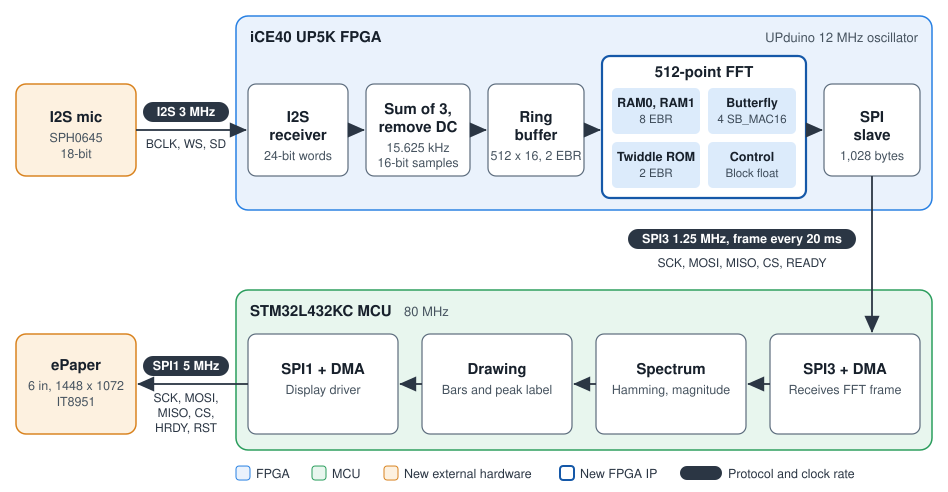

## Status Update
The first portion of the project leading up to the midpoint checkoff was focused on the FPGA pipeline. Every verilog module from the mic to the SPI slave was created and instantiated in a top-level module, fpga-top. Modules have been tested in simulation and on hardware and they work in both cases. 
Additionally, all parts have been ordered and the most important one, our mic, was delivered and works. We currently have a couple more mics en route, in case any damage occurs to the current one we’re using. The e-Paper display will likely be delivered to us by Saturday. 

### Riskiest element update
The riskiest element of our project has been completed. The FFT shown in “A Tutorial-style Single Cycle Fast Fourier Transform Processor” was modified to fit the UP5K FPGA. It now takes two cycles, because of the synchronous EBRs on the UP5K. In order to control the bit growth without clipping all inputs to seven bits, the outputs of the butterfly multiples are always shifted down by one. This means the final output is divided by 512, which we can use to rescale. This design has been verified in simulation and in hardware. 
## FPGA Block Diagrams 
Block diagrams of the logic on your FPGA
## Breadboard Schematics
Schematics of anything on a breadboard

## System Block Diagram
{fig-alt="System block diagram. An I2S microphone feeds the iCE40 UP5K FPGA at 3 MHz. The FPGA contains an I2S receiver, a block that sums 3 samples and removes DC, a ring buffer, a 512-point FFT, and an SPI slave. The FPGA sends a 1,028-byte frame every 20 ms over SPI3 at 1.25 MHz with a READY line to the STM32L432KC MCU, which contains SPI3 with DMA, spectrum processing, drawing, and SPI1 with DMA. The MCU drives the 6-inch ePaper display over SPI1 at 5 MHz."}

## Appendix A: Verilog Code
The most updated code can be found on the [mic-fft-spi branch](https://github.com/GabeAlencar/AVIPEe155/tree/mic-fft-spi/fpga/src) on the GitHub repo. 

