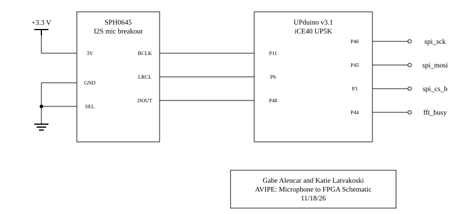
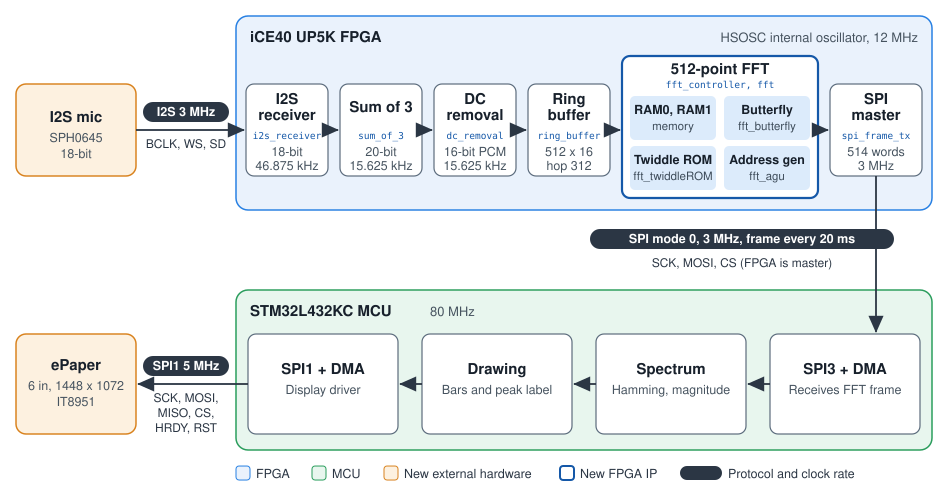

## Status Update
The first portion of the project leading up to the midpoint checkoff was focused on the FPGA pipeline. Every verilog module from the mic to the SPI slave was created and instantiated in a top-level module, fpga-top. Modules have been tested in simulation and on hardware and they work in both cases. 
Additionally, all parts have been ordered and the most important one, our mic, was delivered and works. We currently have another mic ordered, in case any damage occurs to the current one we’re using. The e-Paper display will likely be delivered to us by Sunday. 

## Schematic
{fig-alt="Schematic. The SPH0645 I2S microphone breakout's 3V pin connects to +3.3 V, and its GND and SEL pins connect to ground. BCLK connects to FPGA pin P11, LRCL to P6, and DOUT to P48 of the UPduino v3.1 iCE40 UP5K. On the right, the FPGA outputs spi_sck on P46, spi_mosi on P45, spi_cs_b on P3 and fft_busy on P44 as ports."}

## Block Diagrams

### System Block Diagram
{fig-alt="System block diagram. An SPH0645 I2S microphone sends 18-bit samples to the iCE40 UP5K FPGA at a 3 MHz bit clock. Inside the FPGA, i2s_receiver feeds sum_of_3, then dc_removal, then a 512 by 16 ring_buffer, then the 512-point FFT (fft_controller and fft, with two RAMs, a butterfly, a twiddle ROM and an address generator), then the SPI driver (spi_frame_tx). The FPGA is the SPI master and sends a 514-word frame every 20 ms to the STM32L432KC MCU at 3 MHz over SCK, MOSI and CS. The MCU contains SPI3 with DMA, spectrum processing, drawing, and SPI1 with DMA, and drives the 6-inch ePaper display over SPI1 at 5 MHz."}

### FPGA Block Diagram
::: {.column-screen-inset}
{style="width: 82%; justify-self: center;" fig-alt="FPGA block diagram of fpga_top. The SPH0645 microphone connects to u_i2s_receiver through sd, bclk and ws. u_i2s_receiver sends sample[17:0] and sample_valid to u_sum_of_3, which sends sum[19:0] and sum_valid to u_dc_removal, which sends pcm[15:0] and pcm_valid to u_ring_buffer. u_fft_controller, which contains the 512-point fft, reads the ring buffer with read_index and read_data on frame_ready, and writes bins with bin_we, bin_addr, bin_data, bins_done and frame_num to u_spi_frame_tx, which drives spi_sck, spi_mosi and spi_cs_b as an SPI master at 3 MHz. u_hsosc divides 48 MHz by 4 for the 12 MHz clock."}
:::

### FFT Block Diagrams
::: {.column-page}
{fig-alt="Block diagram of fft. fft_agu takes clk, done, reset and enable and produces adrA, adrB, twiddleadr, bfly_we and load. Multiplexers pick the addresses and write data for two singleport_RAM banks, bank0 and bank1, from the load path (rd and the bit-reversed rd_adr from reverseaddr) or from the butterfly outputs. The RAM outputs rd0 and rd1 feed fft_butterfly through multiplexers along with the twiddle from twiddle_rom, and aout and bout go back to the RAMs. An out_idx counter and a sel_pipe register pick which RAM drives the output wd."}
:::

{fig-alt="Block diagram of fft_agu with width 16 and M 9. enable and not done gate a counter cnt that counts to RAM_LAT, and bfly_we is high when cnt equals RAM_LAT. A flyInd register counts up to 2 to the M minus 1, minus 1, and an fftLevel register counts up each time flyInd wraps. flyInd and fftLevel feed adrcalc, which outputs adrA, adrB and twiddleadr."}

{fig-alt="Block diagram of fft_agu_adrcalc with width 16 and M 9. FlyInd is shifted left by 1 to make tempA. tempA is shifted left by fftLevel and by M minus fftLevel and the two are ORed to make adrA. tempA combined with 1 makes tempB, which is shifted and ORed the same way to make adrB. A mask of 256 shifted right by fftLevel is ANDed with FlyInd to make twiddleAdr."}

## Riskiest element update
The riskiest element of our project has been completed. The FFT shown in “A Tutorial-style Single Cycle Fast Fourier Transform Processor” was modified to fit the UP5K FPGA. It now takes two cycles, because of the synchronous EBRs on the UP5K. In order to control the bit growth without clipping all inputs to seven bits, the outputs of the butterfly multiples are always shifted down by one. This means the final output is divided by 512, which we can use to rescale. This design has been verified in simulation and in hardware. 

## Appendix A: Verilog Code
The most updated code can be found on the [mic-fft-spi branch](https://github.com/GabeAlencar/AVIPEe155/tree/mic-fft-spi/fpga/src) on the GitHub repo. 

