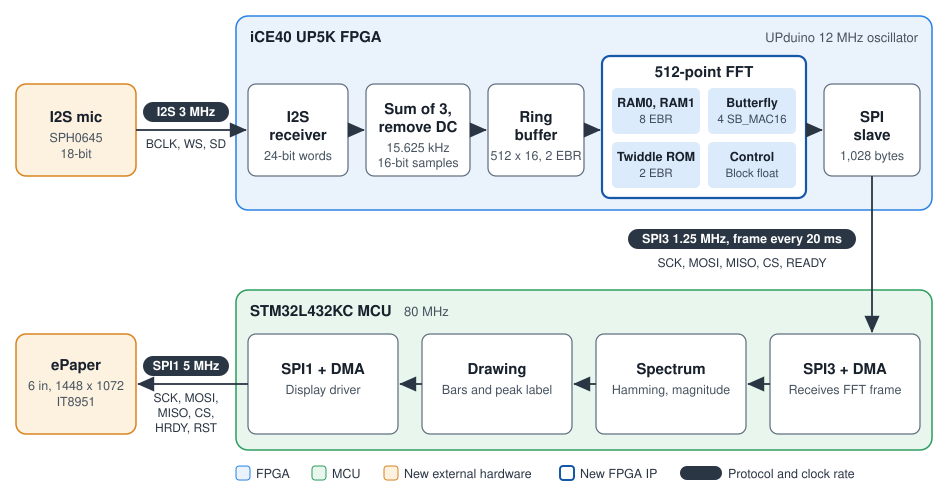

## Project Description and Overview

The goal of this project is to create a proof of concept for the audio processing and display connectivity in AVIPE. 
The device listens to a microphone and shows the frequency content of the sound on an E-Ink display. The FPGA reads 
samples from the microphone over I2S and performs a 512-point FFT every 20 ms. The results are sent over SPI to the 
MCU, which draws a bar graph of the spectrum and labels the peak frequency in Hz.

## Project Specification

- The FPGA runs a 512-point FFT every 20 ms on continuous audio.
- The FPGA receives audio from the microphone with an I2S receiver.
- The FPGA sends FFT results to the MCU over SPI.
- The display shows a bar graph of the spectrum from 0 to 7.8 kHz with 254 bars and a labeled frequency axis.
- The display shows the peak frequency in Hz.
- The display refresh starts within 750 ms of the end of an audio frame.
- A new spectrum is fully drawn within 2 s.
- The MCU writes each image to the display over SPI with DMA in under 1 s.

## New Hardware

- New MCU peripheral: DMA receives the FFT frames from SPI3 and sends the display data through SPI1.
- New FPGA IP: The FFT processor uses the SB_MAC16 DSP blocks and embedded block RAM (EBR).
- New external hardware: The project adds an SPH0645 I2S MEMS microphone and a 6-inch 1448 x 1072 E-Ink display with an IT8951 controller.

## FPGA Design Details

I2S Mic sample (24 bits) → I2S FPGA receiver → Sum of 3 samples → DC removal (16 bit PCM) → Ring buffer (512 x 16 bits) → 512 pt FFT module SB_MAC16 → SPI frame to MCU

The ring buffer stores samples continuously. Every 312 samples (20 ms), the FPGA copies the latest 512 samples into the FFT RAM, runs the FFT, and raises READY. 

### Audio 

- Clock: The FPGA uses the UPduino's 12 MHz oscillator.
- Sample rate: The microphone datasheet supports a BCLK of 2.048 to 4.096 MHz, so we run it at 3 MHz. Adding each group of 3 samples reduces the 46.875 kHz rate to 15.625 kHz.
- DC removal: The microphone has a typical DC offset. The FPGA subtracts a slow running average.
- Gain: Speech at 65 dB SPL arrives near -55 dBFS, so the FPGA keeps the lower 16 bits of the 20-bit sum, saturating at the limits. This gives a gain of 12, and sound above 98 dB SPL clips.

### FFT Design

The FFT is based on the radix-2 processor in Vercruysse et al., "[A Tutorial-style Single-cycle Fast Fourier Transform Processor](https://doi.org/10.1145/3526241.3530329)" (GLSVLSI 2022), with a butterfly unit, ping-pong RAMs, a twiddle factor ROM, and a control unit. Two changes are needed:

- Memory: The paper assumes asynchronous-read RAM with two ports. The UP5K EBR is synchronous with one read port and one write port, so each butterfly takes multiple cycles: read a, read b, compute, write a, and write b.
- Bit growth: A 512-point FFT can grow by 9 bits, and padding for that as the paper does would leave 7-bit samples. We use block floating point instead. A butterfly can grow a value by at most 1 + √2 ≈ 2.4 times, so each level shifts right by 0, 1, or 2 bits, based on the largest value from the level before. The total shift (0 to 18) is sent to the MCU in the frame header.

| Requirement for Voice Recognition | Our Design | Reason |
|---|---|---|
| Frequency range | 0 to 7.8 kHz | Covers voices and high-frequency sounds produced by humans |
| Frequency resolution | 30.5 Hz per bin | Fine enough to separate speech sounds |
| Frame length | 32.8 ms | Speech is roughly steady over 20 to 40 ms |
| Time between frames | 20 ms | Tracks changes in speech with no gaps |

: FFT requirements for voice recognition

| FFT Parameter | Value |
|---|---|
| Points | 512 |
| Levels | 9 |
| Butterflies | 256 per level, 2,304 total |
| Number format | Q1.15, with 16-bit real and 16-bit imaginary parts in one 32-bit word |
| Input bits per sample | 16 (from 18-bit microphone samples) |
| Overflow handling | Block floating point |
| Multipliers | 4 of 8 SB_MAC16 blocks |

: FFT parameters

| Memory | Size | EBR Blocks (256 x 16) |
|---|---|---|
| Ring buffer | 512 x 16 bits | 2 |
| RAM0 | 512 x 32 bits | 4 |
| RAM1 | 512 x 32 bits | 4 |
| Twiddle ROM | 256 x 32 bits | 2 |
| **Total** |  | **12 of 30** |

: FFT memory

## New MCU Features

- Frame capture: The MCU waits for READY and uses SPI3 with DMA to receive each FFT frame.
- Spectrum processing: The MCU applies the Hamming window, computes the magnitude of bins 1 to 254, and finds the largest.
- Drawing: The MCU draws the bars and peak label one row at a time because one image is larger than the 64 KB of SRAM.
- ePaper driver: The MCU sends the IT8951 command sequence with HRDY waits, using SPI1 with DMA.

The Hamming window can be applied after the FFT by combining each bin with its two neighbors, as shown in Lyons, *[Understanding Digital Signal Processing](https://www.iro.umontreal.ca/~mignotte/IFT3205/Documents/UnderstandingDigitalSignalProcessing.pdf)*, Section 13.3, using:

$$X_w[k] = 0.54\,X[k] - 0.23\,(X[k-1] + X[k+1])$$

## Block Diagram

{fig-alt="System block diagram. An I2S microphone feeds the iCE40 UP5K FPGA at 3 MHz. The FPGA contains an I2S receiver, a block that sums 3 samples and removes DC, a ring buffer, a 512-point FFT, and an SPI slave. The FPGA sends a 1,028-byte frame every 20 ms over SPI3 at 1.25 MHz with a READY line to the STM32L432KC MCU, which contains SPI3 with DMA, spectrum processing, drawing, and SPI1 with DMA. The MCU drives the 6-inch ePaper display over SPI1 at 5 MHz."}

## Calculations

The microphone sends one sample every 64 BCLK cycles, and 12 MHz / 4 gives a BCLK of 3 MHz. Adding each group of 3 samples sets the final sample rate:

$$f_{mic} = \frac{3 \text{ MHz}}{64} = 46.875 \text{ kHz}$$

$$f_s = \frac{46.875 \text{ kHz}}{3} = 15.625 \text{ kHz}$$

The FFT size sets the frame length, the frequency resolution, and the highest frequency:

$$T_{frame} = \frac{512}{15.625 \text{ kHz}} = 32.8 \text{ ms}$$

$$\Delta f = \frac{15.625 \text{ kHz}}{512} = 30.5 \text{ Hz per bin}$$

$$f_{max} = \frac{15.625 \text{ kHz}}{2} = 7.8 \text{ kHz}$$

A new frame starts every 312 samples:

$$T_{hop} = \frac{312}{15.625 \text{ kHz}} = 20.0 \text{ ms}$$

Copying 512 samples and running 2,304 butterflies at an estimated 5 cycles each takes about 5% of the time between frames:

$$\frac{512 + 2{,}304 \times 5 \text{ cycles}}{12 \text{ MHz}} = 1.0 \text{ ms}$$

The upper half of the FFT mirrors the lower half for real input, so the FPGA sends 256 bins and a 4-byte header with the frame count and total shift:

$$256 \times 32 \text{ bits} + 32 \text{ bits} = 8{,}224 \text{ bits} = 1{,}028 \text{ bytes}$$

The display width in 1-bit mode must be a multiple of 32 pixels, so the image is 1408 pixels wide:

$$1408 \times 1072 \times 1 \text{ bit} = 1{,}509{,}376 \text{ bits} = 188{,}672 \text{ bytes}$$

The time from the end of an audio frame to the start of the display refresh is the sum of three steps, each calculated from the numbers above:

| Step | Calculation | Time |
|---|---|---|
| FPGA copies the samples and runs the FFT | (512 + 2,304 × 5 cycles) / 12 MHz | 1.0 ms |
| FPGA sends the FFT frame to the MCU over SPI3 | 8,224 bits / 1.25 MHz | 6.6 ms |
| MCU sends the image to the IT8951 over SPI1 | 1,509,376 bits / 5 MHz | 302 ms |

: Time from the end of an audio frame to the start of the refresh

$$1.0 \text{ ms} + 6.6 \text{ ms} + 302 \text{ ms} \approx 310 \text{ ms}$$

This is well under the 750 ms specification. The 302 ms assumes the MCU builds each 176-byte row before SPI1 finishes sending the previous one, which gives it 282 µs, or about 22,500 cycles at 80 MHz, per row. The MCU's windowing and magnitude calculations for 254 bins take well under 1 ms at 80 MHz, and the IT8951 command overhead is not included.

Waveshare lists a full refresh time of under 1 s for the [6-inch HD display](https://www.waveshare.com/6inch-HD-e-Paper-HAT.htm), so a new spectrum is fully drawn in about 310 ms + 1 s ≈ 1.3 s, which meets the 2 s specification.

One update takes about 1.3 s, so about 65 FFT frames arrive during each update. The MCU ignores them while it is busy and draws the newest frame once it is free. The 310 ms is measured from the end of that frame. The MCU keeps that frame's bar heights fixed until the whole image is sent, so every row comes from the same frame.

| Link | Protocol | Wires | Rate | Bits |
|---|---|---|---|---|
| Mic to FPGA | I2S | 3 (BCLK, WS, SD), SEL tied to GND | BCLK 3 MHz, 46,875 samples/s | 24-bit sample sent most-significant bit first, with 18 bits of precision |
| FPGA to MCU | SPI3 (PB3, PB4, PB5) | 5 (SCK, MOSI, MISO, CS, READY) | 1.25 MHz SCK, 6.6 ms per frame, 412 kbit/s | One 1,028-byte frame: 4-byte header, then 256 bins of 16-bit real and 16-bit imaginary data |
| MCU to ePaper | SPI1 (PA1, PA11, PA12) | 6 (SCK, MOSI, MISO, CS, HRDY, RST) | 5 MHz SCK, 0.30 s per image | One image: 1408 x 1072 x 1 bit = 1,509,376 bits (188,672 bytes) |

: Communication links

## Riskiest Element of the Project

The riskiest element of the project is the FFT memory and scaling design. The design in the paper cannot be used directly because of the UP5K block RAM, and it does not include block floating point. We need to redesign the control logic for multi-cycle butterflies and verify it against a reference FFT in simulation.

## Division of Labor

- We will create the high level schematics and diagrams together.
- Each member will be assigned individual modules, and we will share the higher level modules.
- We will complete all work in a shared GitHub repository.
- We will use AI, and each member is responsible for their final code and for understanding the full design.
- Each member will make weekly commits with detailed messages.

## Schedule

Gabe owns the audio front end and the display. Katie owns the FFT, the FPGA to MCU link, and the spectrum processing. We do the reports, presentations, integration, and testing together.

| Date | Milestone | Owner |
|---|---|---|
| 11/3 - 11/4 | Proposal redo | Both |
| 11/7 | Parts confirmed with instructors and ordered | Katie |
| 11/10 | I2S receiver and DC removal simulated | Gabe |
| 11/10 - 11/17 | Design review presentation | Both |
| 11/14 | FFT simulated and matched against a reference FFT | Katie |
| 11/17 - 11/18 | Midpoint report and demo: mic samples through the FFT to the MCU over SPI | Both |
| 11/24 | Display driver draws a test image | Gabe |
| 12/1 | Full system integrated | Both |
| 12/8 - 12/9 | Final checkoff | Both |
| 12/10 | Final report website | Both |
| 12/11 | Demo Day | Both |

: Project schedule

### Gantt Chart

```{mermaid}
%%{init: {"theme": "base", "themeVariables": {
  "fontFamily": "inherit",
  "sectionBkgColor": "#f8f9fa", "altSectionBkgColor": "#ffffff", "sectionBkgColor2": "#f8f9fa",
  "gridColor": "#dee2e6", "titleColor": "#212529",
  "taskBkgColor": "#cfe2ff", "taskBorderColor": "#2780e3",
  "activeTaskBkgColor": "#d1f2e0", "activeTaskBorderColor": "#198754",
  "doneTaskBkgColor": "#e9ecef", "doneTaskBorderColor": "#6c757d",
  "taskTextColor": "#212529", "taskTextDarkColor": "#212529",
  "taskTextLightColor": "#212529", "taskTextOutsideColor": "#212529"
}}}%%
gantt
    dateFormat YYYY-MM-DD
    todayMarker off
    axisFormat %m/%d
    tickInterval 1week
    weekday monday

    section Gabe
    I2S receiver, DC removal, and gain    :g1, 2026-11-04, 7d
    Ring buffer and frame copy            :g2, 2026-11-09, 4d
    Microphone bring-up on the FPGA       :g3, 2026-11-11, 5d
    IT8951 display driver                 :g4, 2026-11-16, 9d
    Row-by-row drawing                    :g5, 2026-11-22, 9d

    section Katie
    Confirm and order parts               :active, k1, 2026-11-03, 5d
    FFT design and simulation             :active, k2, 2026-11-04, 11d
    FPGA SPI slave and READY              :active, k3, 2026-11-11, 5d
    MCU SPI3 receive with DMA             :active, k4, 2026-11-13, 5d
    Spectrum processing                   :active, k5, 2026-11-19, 8d

    section Both
    Proposal redo                         :done, b1, 2026-11-03, 2d
    Design review presentation            :done, b2, 2026-11-10, 8d
    Midpoint report and demo              :done, milestone, b3, 2026-11-17, 0d
    System integration                    :done, b4, 2026-11-25, 7d
    Testing and tuning                    :done, b5, 2026-12-02, 6d
    Final report website                  :done, b6, 2026-12-01, 10d
    Final checkoff                        :done, b7, 2026-12-08, 2d
    Demo Day                              :done, milestone, b8, 2026-12-11, 0d
```

## BOM/Budget

| Part | Part Number | Vendor | Quantity | Price | Price + shipping/tax | Link |
|---|---|---|---|---|---|---|
| E155 development board | UPduino v3.1, NUCLEO-L432KC | Course kit | 1 | Provided |  |  |
| Microphone | SPH0645LM4H-B | Adafruit | 1 | \$6.95 |  | [link](https://www.adafruit.com/product/3421) |
| Display | 6inch HD e-Paper HAT | Waveshare | 1 | \$113.99 |  | [link](https://www.waveshare.com/6inch-HD-e-Paper-HAT.htm) |
| **Total** |  |  |  | **\$120.94** |  |  |

: Bill of materials
