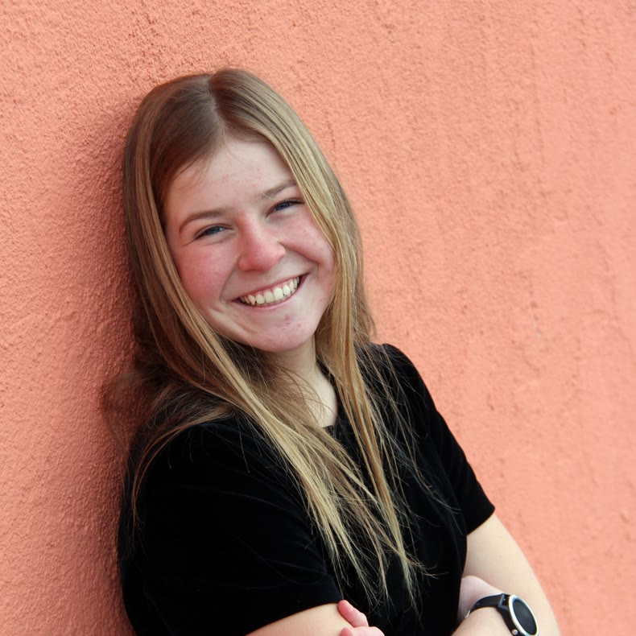

## Gabe Alencar

{width=200 fig-alt="Headshot of Gabe Alencar"}

Gabe Alencar is a senior studying Computer Engineering at Harvey Mudd College who
is interested in RISC-V design and verification and in how hardware can better
support modern AI workloads.

[Portfolio](https://gabealencar.github.io/hmc-e155-portfolio/) |
[LinkedIn](https://www.linkedin.com/in/gabe-alencar/) |
[GitHub](https://github.com/gabealencar)

## Katie Latvakoski

{width=200 fig-alt="Headshot of Katie Latvakoski"}

Katie Latvakoski is an engineering student at Harvey Mudd College with a focus in
biomedical engineering who runs track and cross country for Claremont-Mudd-Scripps.

[Portfolio](https://klatvakoski.github.io/E155_Website/) |
[LinkedIn](https://www.linkedin.com/in/katie-latvakoski-920224378) |
[GitHub](https://github.com/klatvakoski)
