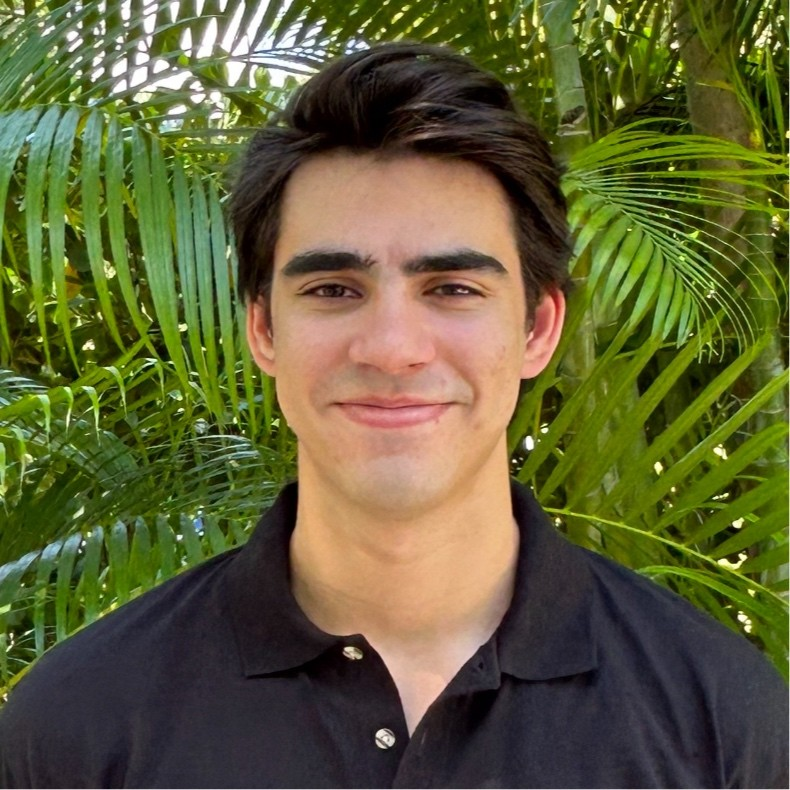

## Gabe Alencar

{width=200 fig-alt="Headshot of Gabe Alencar"}

Gabe Alencar is a senior studying Computer Engineering at Harvey Mudd College who
is interested in RISC-V design and verification and in how hardware can better
support modern AI workloads.

[Portfolio](https://gabealencar.github.io/hmc-e155-portfolio/) |
[LinkedIn](https://www.linkedin.com/in/gabe-alencar/) |
[GitHub](https://github.com/gabealencar)

## Teammate

::: {.callout-warning title="To do"}
Add your teammate's name, one-sentence bio, photo, and links.
:::
