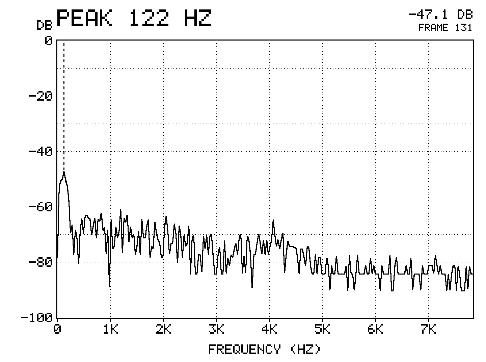

# Display MCU (STM32L432KC)

The MCU receives each FFT frame from the FPGA on SPI3 and draws the spectrum on the Waveshare 6inch HD e-Paper HAT (IT8951 controller, 1448 x 1072). The plot is the same as `fpga/model/fft_live.py`: |X[k]| in dB from -100 to 0 against frequency from 0 to 7.8 kHz, with the peak frequency in the title.



`test/preview.png` was drawn by this code on a PC from frame 131 of a live capture (see "Preview on a PC" below).

## Files

| File | What it does |
|---|---|
| `src/config.h` | Pins, VCOM, waveform modes, image size, sample rate. Everything you may need to change. |
| `src/main.c` | Receive a frame, compute the spectrum, draw it, repeat. Logs to the SEGGER debug terminal (RTT). |
| `src/fpga_link.c` | SPI3 slave receive with DMA2 channel 1, aligned to the FPGA's cs_b. |
| `src/spectrum.c` | dB magnitude and peak, the same math as `magnitude_db()` in `fft_live.py`. Optional Hamming window (`USE_HAMMING`). |
| `src/plot.c` | Draws the plot 16 rows at a time, because the whole 190 KB image does not fit in the 64 KB SRAM. |
| `src/it8951.c` | IT8951 driver over SPI1, with DMA1 channel 3 for the image data. Draws the next band while DMA sends the current one. |
| `lib/` | E155 lab libraries (GPIO, RCC, FLASH) from lab 7. |
| `segger/avipe_display.emProject` | SEGGER Embedded Studio project. |
| `test/` | PC preview of the plot (`render_host.c`, `frame_from_capture.py`). |

## Wiring

Every MCU pin here is on the E155 breadboard adapter (J1 and J3 are the adapter's two 20-pin headers). PA1 and PA4 are not on the adapter, so the display clock is on PA5 and the FPGA cs_b is on PA9. Leave adapter J3-9 (PB7) unconnected: the Nucleo ties it to PA5.

| Signal | MCU pin | Adapter pin | Other end | HAT 40-pin header |
|---|---|---|---|---|
| e-paper SCLK | PA5, SPI1_SCK | J1-17 | HAT SCLK | 23 |
| e-paper MOSI | PA12, SPI1_MOSI | J3-10 | HAT MOSI | 19 |
| e-paper MISO | PA11, SPI1_MISO | J3-6 | HAT MISO | 21 |
| e-paper CS | PA8 | J1-14 | HAT CS | 24 |
| e-paper HRDY | PB0 | J1-11 | HAT HRDY | 18 |
| e-paper RST | PB1 | J3-8 | HAT RST | 11 |
| e-paper 5V | +5V | J1-19 | HAT 5V | 2 |
| e-paper GND | GND | J1-18 | HAT GND | 6 |

The FPGA link needs no wires: fpga_top drives sck, mosi and cs_b on P21, P10 and P25, which dev board DIP switch SW7 connects to PB3, PB5 and PA9. Turn on only those three SW7 switches (PB3-P21, PB5-P10, PA9-P25) and leave the rest off, since PA5 and PA11 are the display's SPI. Jumpers through the ribbon cable and back made sck ring and double-count bits. PB4, between PB3 and PB5 on the ribbon, is driven low as a shield.

Set the HAT's interface switch to SPI. The FPGA's `fft_busy` and UART pins are not needed.

## What it shows

`SPECTROGRAM` in `config.h` picks the screen:

- 1: a sweeping spectrogram (`spectrogram.c`). Time runs left to right over `SWEEP_SECONDS` (10 s), frequency bottom to top, loudness as dithered black. Frames are received in the background (cs_b interrupt + DMA), and every `SG_STEP_US` (0.2 s) only the strip at the scan line is redrawn with the fast A2 waveform. The peak readout in the title refreshes once a second alongside it, and the whole screen gets a GC16 clear after each pass.
- 0: the `fft_live.py` style dB vs frequency plot of the newest frame (`plot.c`).

`SHOW_IMAGE` shows a picture made with `test/make_image.py` (the generated `image_data.h` is gitignored), and `TEST_SCREEN_ONLY` shows the bring-up test screen.

## Display bring-up

1. Read the VCOM value on the display's flat cable (for example `-1.53V`) and set `EPD_VCOM_MV` in `config.h` (1530 for that example).
2. Set `TEST_SCREEN_ONLY` to 1, build, and run. The debug terminal should print the panel size (1448 x 1072) and the firmware and LUT versions. If it times out, check the 5 V supply, the SPI switch, and HRDY.
3. The screen should match the test pattern: a border, a diagonal from the top left to the bottom right, "TOP LEFT" and "BOTTOM RIGHT" in those corners, and a ruler with a mark every 8 pixels.
   - Text broken up in 8-pixel groups means the bit order is wrong: flip `EPD_LSB_FIRST`.
   - Pairs of 8-pixel groups swapped means the byte order is wrong: flip `EPD_SWAP_BYTES`.
   - Both are guesses from the IT8951 guide and Waveshare's code, so check them first.
4. Set `TEST_SCREEN_ONLY` back to 0 and connect the FPGA.

Each update uses DU, a fast black and white waveform. Every 30th update (`EPD_FULL_EVERY`) uses GC16 to clear the ghosting that DU leaves. The log prints how long each update takes.

## How the frame is received

The FPGA is the SPI master (`spi_frame_tx.sv`). Every 20 ms it sends 514 16-bit words in mode 0 at 3 MHz, with cs_b low for the whole frame (about 2.7 ms):

```
A55A | {frame number, STAGE_SHIFT} | re X[0], im X[0], ..., re X[255], im X[255]
```

The MCU watches cs_b as a GPIO. After cs_b rises at the end of a frame, it resets SPI3, starts DMA for 514 words, and enables SPI3 in the gap before the next frame, so every word stays aligned. A frame whose first word is not `A55A` is dropped. Frames that arrive while the display is updating are dropped too, so each update shows the newest frame.

## Preview on a PC

`render_host.c` runs `spectrum.c` and `plot.c` on a PC and writes the image the display would show. From `mcu/test`, in WSL or Linux:

```bash
gcc -O2 -I../src render_host.c ../src/plot.c ../src/spectrum.c -lm -o render_host
python frame_from_capture.py ../../fpga/model/captures/spi_live.bin --index 30 | ./render_host > plot.pgm
./render_host -t > test.pgm      # the bring-up test screen
```

`frame_from_capture.py` reads captures in the current `fft_live.py` format (with a checksum). The older `fft_*.bin` captures use an earlier format and do not parse.
